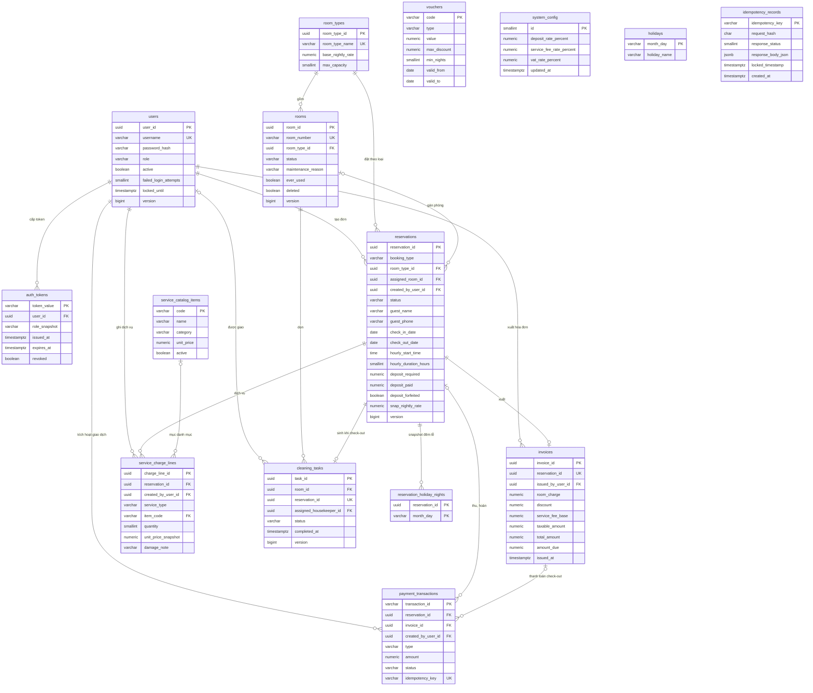

# HMS – Lược đồ cơ sở dữ liệu PostgreSQL v2

Lược đồ CSDL của Hệ thống Quản lý Khách sạn (SUT đồ án SE113, Nhóm 12). Bản v2 bám **Data Dictionary của TEAM12_SRS.docx (mục 4.3, Table 2–16)** cho bảng và cột, và bám **HMS – Business Rules v1.2** cho ràng buộc. Gồm 15 bảng, viết cho PostgreSQL 14 trở lên (đã chạy trên Neon PostgreSQL 17).

File đi kèm:
- `db/migration/V1__init_schema.sql`: tạo lược đồ (Flyway).
- `db/migration/V2__seed_data.sql`: dữ liệu mẫu theo Phụ lục BR v1.2.
- `db/test/test_constraints.sql`: bộ kiểm thử ràng buộc. Mỗi case bị chặn phải bị chặn **đúng ràng buộc mong đợi**.
- Bản v1 (16 bảng, PK BIGINT) lưu nguyên trạng ở `db/original_v1/`.

## 1. Quyết định thiết kế chính

| Chủ đề | Quyết định | Lý do / BR |
| --- | --- | --- |
| Nguồn cấu trúc | Bảng, cột đúng SRS 4.3; tên snake_case; không có cột ngoài SRS | SRS, ERD v2, Class Diagram và mã domain đã khớp nhau; SRS 5.5 yêu cầu snake_case |
| Khóa chính | `UUID`, `DEFAULT gen_random_uuid()` | SRS dùng UUIDv4; domain nhận `UUID id` truyền vào trước khi lưu |
| Hệ quản trị | PostgreSQL ≥ 14 | Cần `EXCLUDE USING gist` để chặn đặt trùng phòng ngay ở CSDL (BR-60, BR-64) |
| Tiền | `NUMERIC(15,0)` | VNĐ nguyên, ánh xạ `BigDecimal` (BR-50) |
| Tỷ lệ | `NUMERIC(5,2)` | BR-44, BR-88 |
| Thời điểm | `TIMESTAMPTZ` (UTC) | BR-06 |
| Ngày, giờ nghiệp vụ | `DATE`, `TIME` theo giờ Asia/Ho_Chi_Minh | Check-in/out, giờ bắt đầu HOURLY (BR-03, BR-04, BR-06) |
| Enum | `VARCHAR` + CHECK | JPA `@Enumerated(STRING)` |
| Khóa lạc quan | `version BIGINT` trên users, rooms, reservations, cleaning_tasks | BR-92, BR-94, BR-114 |
| Ràng buộc | Mỗi điều kiện nguyên tử là một ràng buộc có tên | Test chỉ ra đúng điều kiện bị vi phạm |
| Xóa phòng | Xóa mềm (`deleted`), xóa cứng chỉ khi chưa từng dùng | SRS Table 5, BR-102, OPEN-18 |
| Hóa đơn | Bất biến sau ISSUED (trigger) | BR-54 |

**Nguyên tắc:** ràng buộc CSDL là **lưới an toàn thứ hai**. Logic chính nằm ở domain (lớp thuần), CSDL chặn dữ liệu sai mà bug ở tầng service có thể lọt qua.

## 2. Sơ đồ ERD



Sơ đồ chỉ ghi các cột chính. `system_config`, `holidays`, `vouchers` đứng riêng vì đơn không trỏ khóa ngoại tới chúng mà **sao chép giá trị** vào snapshot lúc đặt (BR-55).

## 3. Bảng theo module và đối chiếu SRS

| Module | Bảng vật lý | SRS | BR chính |
| --- | --- | --- | --- |
| F01 | `users` | Table 2 USERS | BR-70 đến BR-78, BR-93, BR-94 |
| F01 | `auth_tokens` | Table 3 AUTH_TOKENS | BR-72, BR-73, BR-93 |
| F02 | `room_types` | Table 4 ROOM_TYPES | BR-101, BR-103 |
| F02 | `rooms` | Table 5 ROOMS | BR-65, BR-100, BR-102, BR-104, BR-120 |
| F03 | `reservations` | Table 6 RESERVATIONS | BR-03 đến BR-09, BR-20 đến BR-27, BR-31, BR-32, BR-55, BR-60 đến BR-66 |
| F03 | `reservation_holiday_nights` | Table 7 | BR-33, BR-55 |
| F05 | `vouchers` | Table 8 VOUCHERS | BR-40, BR-44 |
| Cấu hình | `system_config` | Table 9 | BR-88 |
| Cấu hình | `holidays` | Table 10 | BR-33, BR-89 |
| F06 | `service_catalog_items` | Table 11 | BR-110 |
| F06 | `service_charge_lines` | Table 12 | BR-34 đến BR-37, BR-55 |
| F06 | `cleaning_tasks` | Table 13 | BR-111 đến BR-114 |
| F05 | `invoices` | Table 14 | BR-50 đến BR-54 |
| F05 | `payment_transactions` | Table 15 | BR-26, BR-84 đến BR-86, BR-90, BR-91 |
| F05 | `idempotency_records` | Table 16 | BR-90, BR-91 |

Đối chiếu từng cột SRS ↔ cột vật lý nằm trong `db/DB_REPORT.md`.

## 4. Chống overbooking: hai tầng

BR-64 yêu cầu không vượt nguồn cung **theo loại phòng**, còn BR-08 cho phép đơn CONFIRMED chưa gán phòng. Một ràng buộc CSDL không đủ, nên dùng hai tầng.

**Tầng 1 – khóa bi quan theo loại phòng (ứng dụng, BR-92).** Khi đặt phòng, đổi lịch hoặc chuyển OUT_OF_SERVICE:
```sql
SELECT room_type_id FROM room_types WHERE room_type_id = :typeId FOR UPDATE;
-- nguồn cung: phòng của loại, NOT deleted, status <> 'OUT_OF_SERVICE' (BR-61)
-- nhu cầu: đơn CONFIRMED, CHECKED_IN có khoảng chiếm chồng khoảng cần xét
SELECT count(*) FROM reservations
 WHERE room_type_id = :typeId AND status IN ('CONFIRMED','CHECKED_IN')
   AND reservation_occupancy(booking_type, check_in_date, check_out_date,
                             hourly_start_time, hourly_duration_hours) && :range;
```
Index GiST `ix_res_type_active_period` phục vụ truy vấn này.

**Tầng 2 – ràng buộc loại trừ theo phòng cụ thể (CSDL):** `ex_res_room_no_overlap`.

SRS không có cột khoảng chiếm, nên khoảng chiếm được tính bằng hàm `reservation_occupancy(...)` (IMMUTABLE), trả `tsrange` nửa mở `[)` theo giờ địa phương:
- NIGHTLY: ngày check-in 14:00 → ngày check-out 12:00.
- HOURLY: giờ bắt đầu → giờ bắt đầu + số giờ.

Mọi đơn cùng múi giờ Asia/Ho_Chi_Minh (BR-06), nên so sánh trên `timestamp` không múi giờ là đúng. Hệ quả:
- Đơn trả 12:00 và đơn nhận 14:00 cùng ngày không xung đột.
- HOURLY 06:00–12:00 rồi NIGHTLY nhận 14:00 cùng ngày cũng không xung đột.
- Đơn CANCELLED, NO_SHOW, CHECKED_OUT không bị tính (BR-63).
- Kèm unique index một phần `ux_res_one_checked_in_per_room` (BR-82).

## 5. Truy vết BR đến ràng buộc CSDL

| BR | Ràng buộc | Loại |
| --- | --- | --- |
| BR-03, BR-05 | `ck_res_nightly_nights`, `ck_res_nightly_no_hourly` | CHECK |
| BR-04, BR-05 | `ck_res_hourly_fields`, `_same_day`, `_start`, `_hours`, `_end` | CHECK |
| BR-40 | `ck_res_hourly_no_voucher` | CHECK |
| BR-09 | `ck_res_guest_name_trimmed`, `_name_length`, `ck_res_guest_phone`, `ck_res_guest_email`, độ dài VARCHAR | CHECK |
| BR-31, BR-32 | `ck_res_adults`, `ck_res_child_6to11`, `ck_res_child_under6`, `ck_res_hourly_guests` | CHECK |
| BR-20, BR-26 | `ck_res_deposit_required`, `ck_res_deposit_paid` | CHECK |
| BR-21, BR-24 | `ck_res_forfeited_status` | CHECK |
| BR-55, BR-44 | `ck_res_voucher_snap_*`, `ck_res_snap_*` | CHECK |
| BR-60, BR-63, BR-64 | `ex_res_room_no_overlap` (qua `reservation_occupancy`) | EXCLUDE |
| BR-66 | `ck_res_cancelled_at`, `ck_res_no_show_at`, `ck_res_checkin_time`, `ck_res_checkin_room`, `ck_res_checked_out_at` | CHECK |
| BR-08, BR-24 | `ck_res_released_room`: đơn CANCELLED, NO_SHOW không còn giữ phòng | CHECK |
| BR-82 | `ux_res_one_checked_in_per_room` | UNIQUE một phần |
| BR-33, BR-89 | `pk_holidays`, `ck_holiday_month_day_*`, `ck_rhn_month_day_*` | PK, CHECK |
| BR-34, BR-35, BR-36 | `ck_scl_item_*`, `ck_scl_damage_*` | CHECK |
| BR-110 | `ck_catalog_*`, `ux_catalog_code_ci` | CHECK, UNIQUE |
| BR-43 | `ck_inv_discount` | CHECK |
| BR-50, BR-53 | `ck_inv_step5`, `_step8`, `_step10`, `_step11` | CHECK |
| BR-54 | `trg_invoice_immutable`, `uq_inv_reservation` | Trigger, UNIQUE |
| BR-26, BR-91 | `ck_txn_reservation_required`, `ck_txn_invoice_checkout_only` | CHECK |
| BR-86 | `ux_txn_one_checkout_charge`, `ux_txn_one_checkout_refund` | UNIQUE một phần |
| BR-90 | `pk_payment_transactions`, `uq_txn_idempotency_key`, `pk_idempotency_records`, `ck_idem_hash`, `ck_idem_status` | PK, UNIQUE, CHECK |
| BR-91 | `idempotency_records.response_status` cho phép NULL (= đang xử lý): bản ghi cùng thời điểm t (`locked_timestamp`) được lưu ở bước (2), trước khi gọi gateway | Thiết kế cột |
| BR-111, BR-114 | `uq_task_reservation`, `ux_task_one_open_per_room` | UNIQUE |
| BR-112 | `ck_task_assignee`, `ck_task_completed_at` | CHECK |
| BR-44 | `ck_voucher_*`, `ux_voucher_code_ci` | CHECK, UNIQUE |
| BR-88 | `ck_config_*` | CHECK |
| BR-93 | `ux_user_username_ci`, `ck_user_username`, `ck_user_role` | UNIQUE, CHECK |
| BR-71 | `ck_user_failed` | CHECK |
| BR-72 | `ck_token_ttl` | CHECK |
| BR-100, BR-101 | `ux_room_number_ci` (phòng chưa xóa), `ck_room_number`, `ux_room_type_name_ci`, `ck_room_type_*` | UNIQUE, CHECK |
| BR-102 | `trg_room_mark_ever_used`, `ck_room_delete_never_used`, `ck_room_delete_available`, `trg_room_delete_guard`, `fk_rooms_room_type` | Trigger, CHECK, FK |
| BR-104 | `ck_room_oos_reason_required`, `ck_room_reason_only_oos` | CHECK |

Số case test của từng ràng buộc xem `db/DB_REPORT.md`.

## 6. Những gì CSDL không kiểm (giữ ở domain)

- **Nguồn cung theo loại phòng (BR-61, BR-64, BR-69, BR-102 đổi loại):** đếm qua nhiều dòng, dùng `SELECT ... FOR UPDATE` (mục 4).
- **Sức chứa theo loại phòng (BR-32, BR-103):** cần đọc bảng khác.
- **Phòng được gán cùng loại với đơn (BR-81):** không dùng khóa ngoại kép `(assigned_room_id, room_type_id)`. Lý do: BR-102 cho đổi loại một phòng AVAILABLE chưa gán trước, kể cả phòng đã có lịch sử; khóa ngoại kép sẽ chặn việc đó hoặc buộc sửa loại trên các đơn cũ. Domain kiểm khi gán trước và khi check-in.
- **Ma trận chuyển trạng thái (BR-65, BR-66, BR-112):** CSDL chỉ kiểm giá trị hợp lệ và mốc đi kèm. Với nhiệm vụ dọn phòng, SRS không có thời điểm bắt đầu nên CSDL không chứng minh được DONE đã qua IN_PROGRESS.
- **Tính tiền (BR-02, BR-04, BR-10, BR-11, BR-20, BR-30 đến BR-42):** CSDL chỉ kiểm các tổng khớp nhau (BR-53).
- **Mốc theo thời điểm hiện tại (BR-07, BR-21 đến BR-24, BR-62, BR-71, BR-80, hạn 24 giờ của BR-90):** phụ thuộc `ClockProvider`.
- **Số lẻ thập phân (BR-44, BR-88):** `NUMERIC(n,2)` tự làm tròn giá trị có hơn 2 chữ số thập phân. Việc từ chối do domain làm.
- **Số tiền cọc mất (BR-122):** suy từ `deposit_paid` của đơn có `deposit_forfeited` (OPEN-17).
- **Phòng RESERVED liên kết đúng một đơn (BR-08; CSDL chỉ chặn đơn CANCELLED, NO_SHOW còn giữ phòng), Admin cuối cùng (BR-94), người được giao là HOUSEKEEPER đang hoạt động (BR-113), vai trò trong token khớp người dùng.**

## 7. Triển khai

- **Migration:** đặt hai file `V1`, `V2` vào `src/main/resources/db/migration/` khi sang Bước 6 (Spring Boot + Flyway).
- **Unit test lớp thuần:** không cần CSDL.
- **Integration test, test đa luồng (BR-64, BR-82, BR-92):** PostgreSQL trong Testcontainers, cùng phiên bản với Neon (17).
- **Neon:** dùng hai extension `btree_gist`, `pgcrypto`, cả hai chạy được trên Neon. Trước khi đưa Flyway vào DB đã dựng bằng psql, xóa và tạo lại schema hoặc dùng `baselineOnMigrate`.
- **Dữ liệu mẫu:** `V2__seed_data.sql` nạp đúng Phụ lục BR v1.2. Mật khẩu `Hotel@2026` băm BCrypt bằng `pgcrypto`, tương thích `BCryptPasswordEncoder`. Chỉ dùng cho môi trường test.

## 8. Điểm mở đã chốt (Đạt, 21/11/2026)

- **OPEN-16 (BR-122, BR-25):** `type` 4 giá trị không tách hoàn khi hủy với hoàn chênh lệch khi đổi lịch. Mặc định: dòng "tiền hoàn" = tổng `DEPOSIT_REFUND` và `CHECKOUT_REFUND` SUCCEEDED trong kỳ.
- **OPEN-17 (BR-122, BR-21, BR-24):** cọc mất của đơn = `deposit_paid` của đơn CANCELLED/NO_SHOW có `deposit_forfeited = TRUE`, tính theo `cancelled_at` / `no_show_at`.
- **OPEN-18 (BR-102, BR-61, BR-120):** xóa phòng là xóa mềm. Phòng `deleted` không tính nguồn cung, báo cáo; số phòng được dùng lại. Xóa cứng chỉ cho phòng AVAILABLE chưa từng dùng, để xóa được loại phòng.
