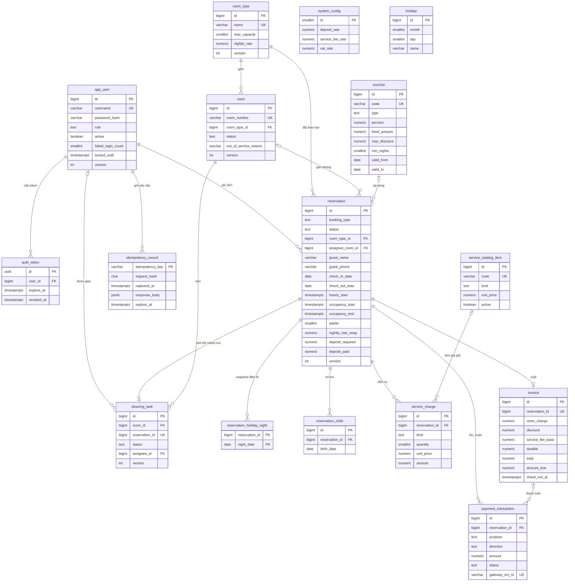

# HMS – Lược đồ cơ sở dữ liệu PostgreSQL v1

Nov 18, 2026 · @Võ Đạt

Lược đồ CSDL của Hệ thống Quản lý Khách sạn (SUT đồ án SE113, Nhóm 12), thiết kế bám theo **HMS – Business Rules v1.2**. Gồm 16 bảng, viết cho PostgreSQL 14 trở lên, dùng được trên Postgres cài ở máy, Docker, Testcontainers và Neon. DDL đi kèm có hai file migration Flyway (`V1__init_schema.sql`, `V2__seed_data.sql`) và một bộ kiểm thử ràng buộc (`test_constraints.sql`): **75/75 case pass trên PostgreSQL 16**.

## 1. Quyết định thiết kế chính

| Chủ đề | Quyết định | Lý do / BR |
| --- | --- | --- |
| Hệ quản trị | PostgreSQL ≥ 14 | Cần `EXCLUDE USING gist` + `tstzrange` để chặn đặt trùng phòng ngay ở tầng CSDL (BR-60, BR-64) |
| Tiền | `NUMERIC(15,0)` (VNĐ nguyên) | Ánh xạ sang `BigDecimal`, không dùng `double`; mỗi dòng đã làm tròn HALF\_UP ở tầng ứng dụng (BR-50) |
| Tỷ lệ | `NUMERIC(5,2)` | Tỷ lệ cọc, phí dịch vụ, VAT, phần trăm voucher có tối đa 2 chữ số thập phân (BR-44, BR-88) |
| Thời điểm | `TIMESTAMPTZ` (lưu UTC) | Quy đổi sang Asia/Ho\_Chi\_Minh qua `ClockProvider` ở tầng ứng dụng (BR-06) |
| Ngày nghiệp vụ | `DATE` | checkIn, checkOut, validFrom, validTo là ngày theo giờ Việt Nam |
| Enum | `TEXT` + `CHECK (... IN ...)` | Dùng thẳng với JPA `@Enumerated(STRING)`, thêm giá trị chỉ cần sửa CHECK |
| Khóa lạc quan | Cột `version` trên các bảng có chuyển trạng thái | Cập nhật có điều kiện theo BR-92 (JPA `@Version`) |
| Snapshot giá | Lưu ngay trên `reservation` + bảng `reservation_holiday_night` | Đổi giá, ngày lễ hay voucher sau khi đặt không ảnh hưởng đơn cũ (BR-55) |
| Xóa dữ liệu | Không xóa tài khoản, hóa đơn bất biến | BR-93 (chỉ vô hiệu hóa), BR-54 (trigger chặn UPDATE/DELETE) |

**Nguyên tắc:** ràng buộc CSDL là **lưới an toàn thứ hai**. Logic nghiệp vụ chính vẫn nằm ở domain (lớp thuần đã viết ở P0–P2), CSDL chặn những dữ liệu sai mà một bug ở tầng service có thể lọt qua. Đây cũng là luận điểm tốt khi vấn đáp về Data Integrity.

## 2. Sơ đồ ERD



Sơ đồ chỉ ghi các cột chính. Đầy đủ cột và ràng buộc nằm trong `V1__init_schema.sql`. Hai bảng `system_config` (một dòng) và `holiday` đứng riêng vì đơn đặt không trỏ khóa ngoại tới chúng mà **sao chép giá trị** vào snapshot lúc đặt (BR-55).

## 3. Danh sách bảng theo module

| Module | Bảng | Vai trò | BR chính |
| --- | --- | --- | --- |
| F01 | `app_user` | Tài khoản, vai trò, bộ đếm sai mật khẩu, khóa 15 phút | BR-70 đến BR-76, BR-78, BR-93 |
| F01 | `auth_token` | Token 30 phút, thu hồi khi đăng xuất, đổi vai trò hoặc vô hiệu hóa | BR-72, BR-73, BR-93 |
| Cấu hình | `system_config` | Một dòng duy nhất: tỷ lệ cọc, phí dịch vụ, VAT | BR-88 |
| Cấu hình | `holiday` | Ngày lễ dương lịch lặp hằng năm | BR-33, BR-89 |
| F02 | `room_type` | Loại phòng, sức chứa, giá đêm hiện hành | BR-101, BR-103 |
| F02 | `room` | Phòng, trạng thái, lý do bảo trì | BR-65, BR-69, BR-100, BR-102, BR-104 |
| F05 | `voucher` | Mã giảm giá PERCENT/FIXED | BR-40, BR-44 |
| F03 | `reservation` | Đơn đặt: loại đơn, khoảng chiếm, khách, snapshot giá, cọc, mốc thời gian | BR-03 đến BR-09, BR-20 đến BR-27, BR-55, BR-60 đến BR-66 |
| F03 | `reservation_holiday_night` | Snapshot các đêm lễ của khoảng thuê | BR-33, BR-55 |
| F03 | `reservation_child` | Ngày sinh trẻ, truy vết cách đếm trẻ 6–11 và dưới 6 | BR-31 |
| F06 | `service_catalog_item` | Danh mục minibar, giặt ủi | BR-110 |
| F06 | `service_charge` | Dòng dịch vụ phát sinh (minibar, giặt ủi, hư hao) với đơn giá chốt lúc thêm | BR-34 đến BR-37, BR-55 |
| F05 | `invoice` | Hóa đơn ISSUED, đủ 11 dòng của BR-50, bất biến | BR-50 đến BR-54, BR-122 |
| F05 | `payment_transaction` | Mọi lần gọi Mock gateway (thu/hoàn, thành công/lỗi) | BR-26, BR-84 đến BR-86, BR-91 |
| F05 | `idempotency_record` | Kho Idempotency-Key 24 giờ, chốt thời điểm t | BR-11, BR-90, BR-91 |
| F06 | `cleaning_task` | Nhiệm vụ dọn phòng, trạng thái riêng | BR-111 đến BR-114 |

## 4. Chống overbooking: hai tầng

BR-64 yêu cầu không bao giờ vượt nguồn cung **theo loại phòng**, còn BR-08 cho phép đơn CONFIRMED chưa gán phòng cụ thể. Vì vậy một ràng buộc CSDL không đủ, mà cần hai tầng:

**Tầng 1 – khóa bi quan theo loại phòng (tầng ứng dụng, BR-92).** Trong giao dịch đặt phòng, đổi lịch hoặc chuyển OUT\_OF\_SERVICE:

```sql
SELECT id FROM room_type WHERE id = :typeId FOR UPDATE;   -- tuần tự hóa theo loại
-- đếm nguồn cung: phòng của loại, không OUT_OF_SERVICE (BR-61)
-- đếm nhu cầu từng đêm / từng khoảng giờ: đơn CONFIRMED, CHECKED_IN chồng khoảng
SELECT count(*) FROM reservation
 WHERE room_type_id = :typeId
   AND status IN ('CONFIRMED','CHECKED_IN')
   AND tstzrange(occupancy_start, occupancy_end, '[)') && tstzrange(:nightStart, :nightEnd, '[)');
-- nhu cầu + 1 <= nguồn cung tại mọi đêm thì mới INSERT
```

Hai luồng cùng tranh suất cuối thì luồng sau phải chờ khóa, đọc lại nhu cầu và nhận `RoomNotAvailableException`. Index GiST `ix_res_type_active_period` giúp truy vấn này nhanh.

**Tầng 2 – ràng buộc loại trừ theo phòng cụ thể (CSDL).**

```sql
EXCLUDE USING gist (
    assigned_room_id WITH =,
    tstzrange(occupancy_start, occupancy_end, '[)') WITH &&)
WHERE (assigned_room_id IS NOT NULL AND status IN ('CONFIRMED','CHECKED_IN'))
```

Ràng buộc này chặn hai đơn đang hiệu lực gán cùng một phòng có khoảng chiếm chồng nhau. Khoảng nửa mở `[)` đúng với quy ước BR-60: đơn trả phòng 12:00 và đơn nhận phòng 14:00 cùng ngày không xung đột (test #34). Đơn CANCELLED, NO\_SHOW, CHECKED\_OUT tự động không bị tính (BR-63, test #35–36). Kèm theo là unique index một phần `ux_res_one_checked_in_per_room` giữ bất biến BR-82: một phòng có tối đa một đơn CHECKED\_IN.

`occupancy_start` và `occupancy_end` do tầng ứng dụng tính (ngày + 14:00 hoặc 12:00 theo giờ Việt Nam rồi đổi sang UTC). Không dùng generated column vì phép `AT TIME ZONE 'Asia/Ho_Chi_Minh'` không phải hàm immutable nên PostgreSQL không cho phép.

## 5. Truy vết BR đến ràng buộc CSDL

Cột "Test" là số thứ tự case trong `test_constraints.sql`; Vy Vy có thể đưa thẳng vào RTM ở cấp Data Integrity.

| BR | Ràng buộc CSDL | Loại | Test |
| --- | --- | --- | --- |
| BR-03, BR-05 | `ck_res_nightly_shape`: đủ ngày, 1 đến 30 đêm, không có trường HOURLY | CHECK | 28–31 |
| BR-04, BR-40, BR-32 | `ck_res_hourly_shape`: 1 đến 10 giờ, không voucher, tối đa 2 người | CHECK | 49–51 |
| BR-09 | `ck_res_guest_name`, `ck_res_guest_phone` (`^[0-9]{9,11}$`), `ck_res_guest_email` | CHECK | 40–46 |
| BR-32 | `ck_res_guests`: người lớn ≥ 1, trẻ dưới 6 ≤ 2 | CHECK | 47–48 |
| BR-26 | `ck_res_deposit`: cọc mất không vượt cọc đã thu | CHECK | 52 |
| BR-60, BR-63, BR-64 | `ex_res_room_no_overlap` | EXCLUDE | 32–36 |
| BR-66 | `ck_res_status_stamps`: CANCELLED phải có `cancelled_at`, CHECKED\_IN phải có phòng | CHECK | 38–39 |
| BR-82 | `ux_res_one_checked_in_per_room` | UNIQUE một phần | 37 |
| BR-34, BR-35, BR-36 | `ck_svc_shape`: số lượng 1–99, hư hao 1–50.000.000 kèm ghi chú | CHECK | 53–57 |
| BR-43 | `ck_inv_discount`: 0 ≤ discount ≤ roomCharge | CHECK | 64 |
| BR-50, BR-53 | `ck_inv_step5`, `step8`, `step10`, `step11`: các tổng đúng bằng cộng/trừ các dòng | CHECK | 59, 62–63, 65 |
| BR-54 | `trg_invoice_immutable` | Trigger | 60–61 |
| BR-86 | `ux_txn_one_checkout_charge`: tối đa một lần thu check-out SUCCEEDED mỗi đơn | UNIQUE một phần | 66–68 |
| BR-90 | `ux_txn_gateway_id`, PK `idempotency_record` | UNIQUE | 69 |
| BR-111, BR-114 | `cleaning_task.reservation_id` UNIQUE, `ux_task_one_open_per_room` | UNIQUE | 71–73 |
| BR-112 | `ck_task_stamps`: IN\_PROGRESS phải có người nhận, DONE phải qua IN\_PROGRESS | CHECK | 74–75 |
| BR-44 | `ck_voucher_shape`, `ck_voucher_period`, `ux_voucher_code_ci` | CHECK, UNIQUE | 23–27 |
| BR-88 | `ck_config_*`, `ck_config_singleton` | CHECK | 7–11 |
| BR-89 | `ck_holiday_valid_date` (loại 31/04, 29/02), `ux_holiday_month_day` | CHECK, UNIQUE | 12–14 |
| BR-93 | `ux_user_username_ci`, `ck_user_username`, `ck_user_role` | UNIQUE, CHECK | 1–5 |
| BR-72 | `ck_token_ttl`: hết hạn đúng 30 phút sau khi cấp | CHECK | 6 |
| BR-100, BR-101 | `ux_room_number_ci`, `ck_room_number`, `ck_room_type_capacity`, `ck_room_type_rate` | UNIQUE, CHECK | 15–18 |
| BR-102 | FK `room.room_type_id` (RESTRICT): không xóa loại còn phòng | FK | 22 |
| BR-104 | `ck_room_oos_reason`: OUT\_OF\_SERVICE bắt buộc có lý do 1–200 ký tự | CHECK | 19–21 |

## 6. Những gì CSDL không kiểm (giữ ở domain)

Các quy tắc dưới đây phụ thuộc dữ liệu nhiều dòng, thời điểm hiện tại hoặc phép tính, nên đặt ở lớp thuần và kiểm bằng unit test, không đưa vào CHECK:

- **Nguồn cung theo loại phòng (BR-61, BR-64, BR-69, BR-102):** đếm qua nhiều dòng, giữ bằng `SELECT ... FOR UPDATE` (mục 4).
- **Sức chứa theo loại phòng (BR-32, BR-103):** người lớn + trẻ 6–11 ≤ `room_type.max_capacity` cần đọc bảng khác.
- **Ma trận chuyển trạng thái (BR-65, BR-66, BR-112):** CSDL chỉ kiểm giá trị hợp lệ và mốc thời gian đi kèm. Bước chuyển hợp lệ do `Room.transitionTo` và `Reservation.*` quyết định, cập nhật có điều kiện `WHERE status = ? AND version = ?`.
- **Tính tiền (BR-02, BR-04, BR-10, BR-11, BR-20, BR-30 đến BR-42):** CSDL chỉ kiểm các tổng khớp nhau (BR-53), không tính lại từng dòng.
- **Mốc thời gian theo `now` (BR-07, BR-21 đến BR-24, BR-62, BR-71, BR-80):** phụ thuộc `ClockProvider`.
- **Tuổi trẻ em (BR-31):** tính từ `reservation_child.birth_date` đến ngày check-in.
- **Phòng RESERVED liên kết đúng một đơn (BR-08), Admin cuối cùng (BR-94), người được giao là HOUSEKEEPER đang hoạt động (BR-113).**

## 7. Triển khai và quan hệ với Neon

- **Migration:** đặt hai file vào `src/main/resources/db/migration/` (Spring Boot + Flyway). Cùng một bộ script dựng lược đồ giống hệt nhau ở mọi môi trường.
- **Unit test lớp thuần:** không cần CSDL.
- **Integration test và test đa luồng (BR-64, BR-82, BR-92):** chạy trên PostgreSQL trong Testcontainers để mỗi lần chạy bắt đầu từ trạng thái sạch. Không chạy trên CSDL dùng chung.
- **Neon (tùy chọn, từ Bước 6):** làm môi trường demo/staging chung cho API test (Postman/Newman) và UI test (Playwright). Lược đồ dùng hai extension `btree_gist` và `pgcrypto`, nên trước khi dùng Neon cần kiểm tra hai extension này có trong danh sách hỗ trợ của Neon.
- **Dữ liệu mẫu:** `V2__seed_data.sql` nạp đúng Phụ lục BR v1.2 (5 tài khoản, 3 loại phòng, 6 phòng, 4 ngày lễ, 6 mục dịch vụ, 2 voucher). Mật khẩu `Hotel@2026` được băm BCrypt bằng `pgcrypto`, tương thích `BCryptPasswordEncoder`. Chỉ dùng cho môi trường test.

## 8. Việc cần xác nhận

- **Tier VIP (BR-41):** BR không định nghĩa thực thể khách hàng (khách không phải actor), nên v1 lưu `guest_vip` trên từng đơn. Nếu nhóm muốn quản lý khách thân thiết thì cần thêm bảng `guest`.
- **Lịch sử trạng thái:** v1 lưu mốc `cancelled_at`, `no_show_at`, `actual_check_in_at`, `actual_check_out_at` đủ cho báo cáo BR-121, BR-122. Chưa có bảng audit lịch sử chuyển trạng thái; thêm nếu giảng viên yêu cầu audit trail.
- **Đồng bộ Class Diagram:** cần thêm vào Class Diagram các phần đang có trong lược đồ: `BookingType`, snapshot giá, `depositRequired`/`depositPaid`, `PaymentTransaction`, `IdempotencyRecord`, `CleaningTask`, `ServiceCatalogItem`, `SystemConfig`, `Holiday` (đúng danh sách "Việc còn mở" của BR v1.2).
- **Stack chưa chốt:** lược đồ viết cho Spring Boot + Flyway. Nếu chọn FastAPI thì giữ nguyên SQL, chỉ đổi công cụ migration sang Alembic.
