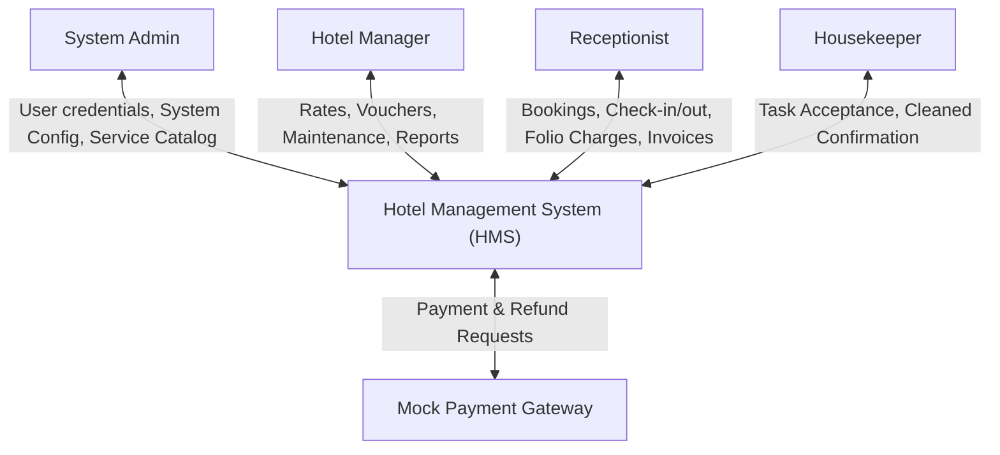
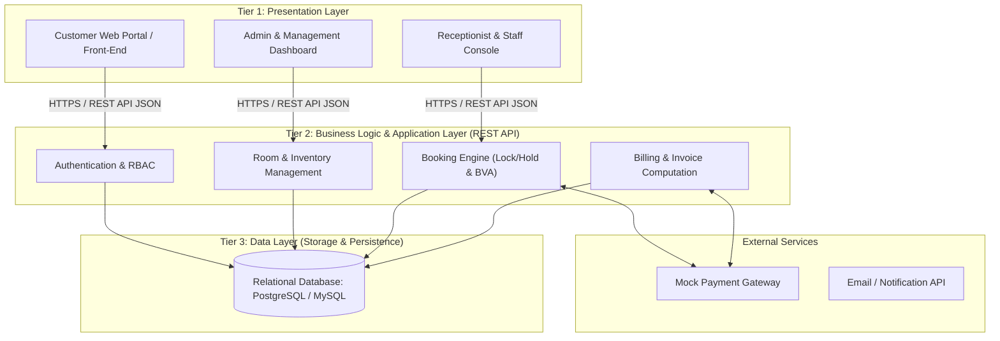
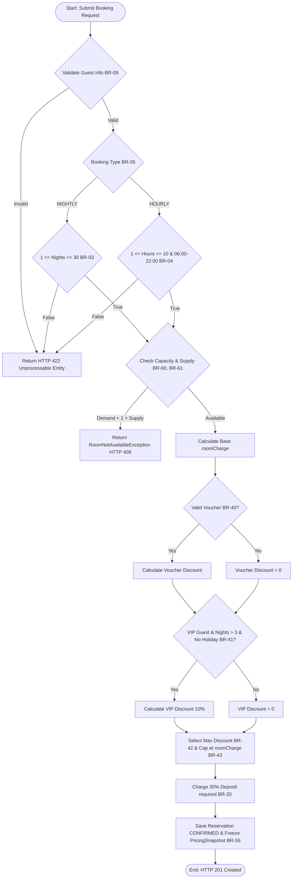
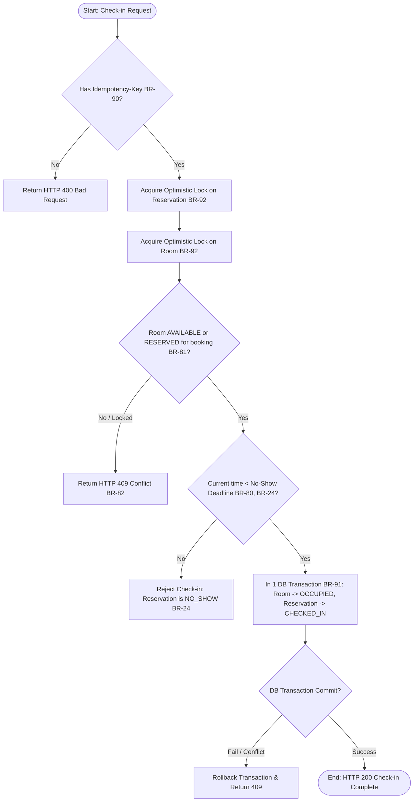
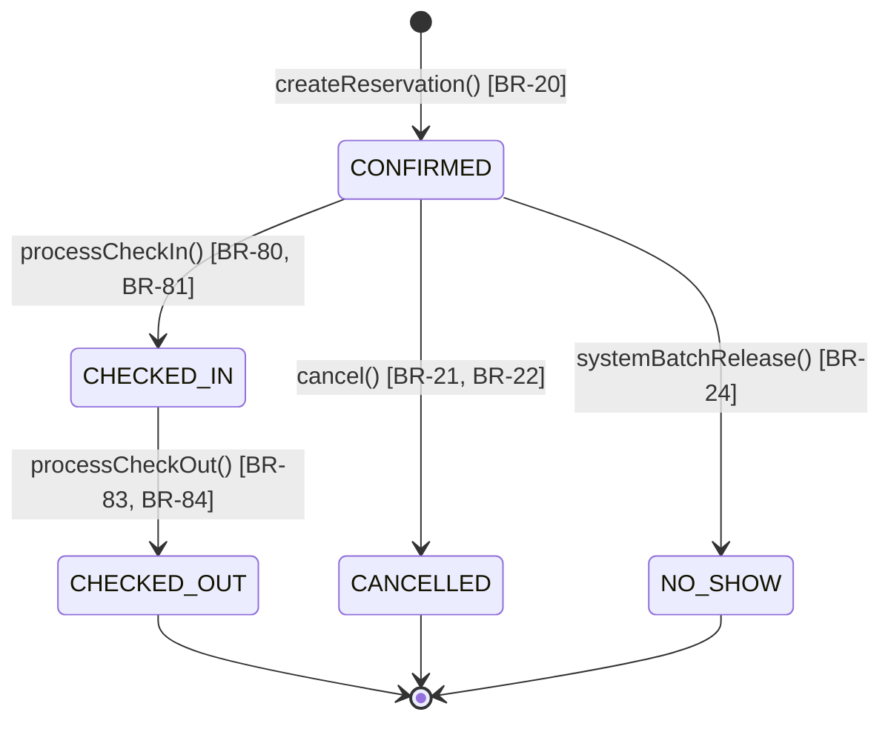
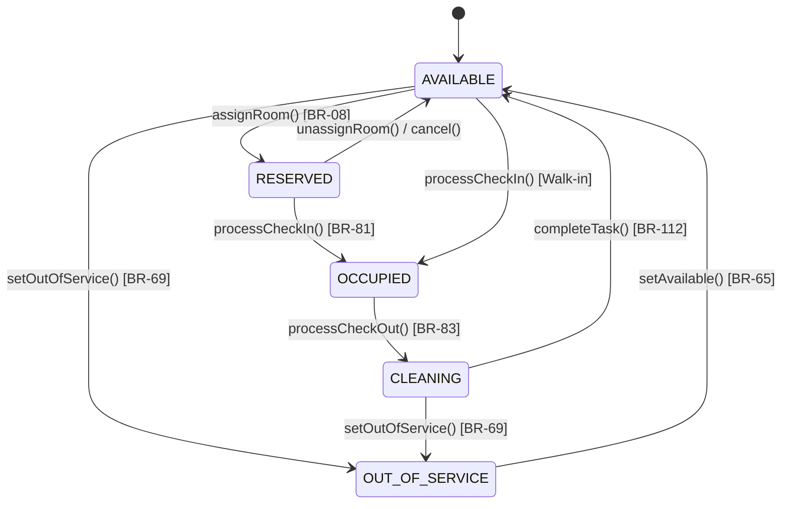

# Software Requirements Specification (SRS)
## for Hotel Management System (HMS)
**Prepared by Team 12**  
**Date: Oct 31, 2026**  
**Version:** 1.2  
**Standard:** IEEE Std 830-1998  

---

## Table of Contents
1. [Introduction](#1-introduction)  
   1.1. [Purpose](#11-purpose)  
   1.2. [Document Conventions](#12-document-conventions)  
   1.3. [Project Scope and Product Features](#13-project-scope-and-product-features)  
   1.4. [Definitions and Acronyms](#14-definitions-and-acronyms)  
2. [Overall Description](#2-overall-description)  
   2.1. [Product Perspective](#21-product-perspective)  
   2.2. [User Classes and Characteristics](#22-user-classes-and-characteristics)  
   2.3. [Operating Environment](#23-operating-environment)  
   2.4. [Design and Implementation Constraints](#24-design-and-implementation-constraints)  
   2.5. [Assumptions and Dependencies](#25-assumptions-and-dependencies)  
   2.6. [Architecture](#26-architecture)  
3. [System Features & Use Case Specifications](#3-system-features--use-case-specifications)  
   3.1. [Use Case Overview](#31-use-case-overview)  
   3.2. [Use Case Detailed Specifications (UC-01 to UC-13)](#32-use-case-detailed-specifications)  
   3.3. [Functional Requirements Breakdown (Auth, Room, Resv, Stay, Billing, HK, Reports)](#33-functional-requirements-breakdown)  
4. [Data Requirements & Data Dictionary](#4-data-requirements--data-dictionary)  
   4.1. [Logical Data Model](#41-logical-data-model)  
   4.2. [Class Diagram Architecture](#42-class-diagram-architecture)  
   4.3. [Data Dictionary (Tables 2 to 16)](#43-data-dictionary)  
5. [Other Non-functional Requirements](#5-other-non-functional-requirements)  
   5.1. [Performance](#51-performance)  
   5.2. [Security](#52-security)  
   5.3. [Usability](#53-usability)  
   5.4. [Reliability & Data Integrity](#54-reliability--data-integrity)  
   5.5. [Maintainability](#55-maintainability)  
6. [Behavioral Models](#6-behavioral-models)  
   6.1. [Activity Diagrams](#61-activity-diagrams)  
   6.2. [Sequence Diagrams](#62-sequence-diagrams)  
   6.3. [State Transition Diagrams](#63-state-transition-diagrams)  

---

## 1. Introduction

### 1.1. Purpose
This Software Requirements Specification (SRS) documents the functional and non-functional requirements for the Hotel Management System (HMS). It defines the system behavior, business rules, operational constraints, and role-based access controls for development and testing.

In the context of the course, this document serves as the reference baseline for:
- Mapping requirements to test cases and defect reports via the **Requirements Traceability Matrix (RTM)**.
- Designing test suites using black-box techniques (Equivalence Partitioning, Boundary Value Analysis, Decision Tables, State Transitions) and white-box testing.
- Implementing automated API, component, and integration tests to verify critical logic, including room availability, concurrency handling, and billing rules.

### 1.2. Document Conventions
No special typographical conventions are used in this SRS.

### 1.3. Project Scope and Product Features
The Hotel Management System (HMS) is a web application that supports daily front-desk and back-office hotel operations. The system covers seven main functional modules:
- **F01 – Authentication & Authorization:** User login/logout, session token management, account lockout after repeated failed attempts, and role-based access control (RBAC).
- **F02 – Room Management:** Configuration of rooms, room types, pricing, capacity limits, and maintenance status tracking (OUT_OF_SERVICE).
- **F03 – Reservation Management:** Creation, updates, and cancellations for nightly and hourly bookings, guest information handling, and overbooking prevention.
- **F04 – Check-in / Check-out:** Room assignment, guest arrival and departure processing, and early check-in or late check-out surcharge calculation.
- **F05 – Billing & Payment:** Calculation of room charges, extra guests, holiday surcharges, vouchers, VAT, incidental fees, and mock payment transactions with idempotency protection.
- **F06 – Service & Housekeeping:** Tracking incidental services (minibar, laundry, room damage) and assigning cleaning tasks upon check-out.
- **F07 – Dashboard & Reports:** Summary view of current room occupancy, booking statistics, and revenue for defined periods.

**Out of Scope:** Real payment gateways (simulated via mock service), complex revenue forecasting, multi-property operations, and payroll/inventory management are excluded to focus on business verification.

### 1.4. Definitions and Acronyms
#### Table 1. Definitions and Acronyms
| Term | Definition |
| :--- | :--- |
| **SRS** | Software Requirement Specification: A document that describes what the software will do and how it will be expected to perform. |
| **HMS** | Hotel Management System: The target software system managing hotel reservations, rooms, and front-desk workflows. |
| **SUT** | System Under Test: The specific software application undergoing testing. |
| **RBAC** | Role-Based Access Control: A method of regulating access to computer or network resources based on the roles of individual users within an enterprise. |
| **RTM** | Requirements Traceability Matrix: A table that links business requirements to test cases and defect tracking items. |
| **BVA** | Boundary Value Analysis: A test design technique that focuses on values at the edges of input equivalence partitions. |
| **EP** | Equivalence Partitioning: A test design technique that divides input data into valid and invalid sets of equivalent behavior. |
| **Idempotency** | A characteristic where repeating the same operation produces the exact same outcome without unintended side effects. |
| **Snapshot** | A fixed record of price, holiday dates, and voucher terms captured at booking time to keep billing unchanged if future configurations change. |
| **OOS** | Out of Service: A room status indicating the unit is under maintenance and temporarily cannot be assigned. |

---

## 2. Overall Description

### 2.1. Product Perspective
The Hotel Management System (HMS) is a standalone web application designed to replace manual logbooks and fragmented operational workflows in hospitality front-desk management. The system centralizes room inventory, reservation handling, guest check-in/check-out processing, incidental billing, and room cleaning coordination into an integrated environment.


*Figure 1. Context Diagram*

### 2.2. User Classes and Characteristics
| User Class | Description & Operational Scope |
| :--- | :--- |
| **System Admin** | Responsible for system maintenance, user administration, and system-wide configurations. Primary responsibilities include provisioning employee accounts, assigning role-based access, and managing system configurations (deposit %, VAT, service fee, holiday calendar, service catalog). Admins also handle physical room and room type setups. They do not perform front-desk operations such as creating bookings, processing check-ins/check-outs, or accepting guest payments. |
| **Hotel Manager** | Oversees daily operations, property occupancy, and operational revenue. Hotel Managers configure room rates, define promotional vouchers, schedule room maintenance, and monitor staff tasks. While they have full operational authority to perform all front-desk duties (reservations, check-in, check-out, and billing) when necessary, their routine interaction focuses on analyzing operational metrics, tracking cancellation trends, and reviewing gross revenue reports across custom reporting intervals. |
| **Receptionist** | Represents the primary operational user of the system and interacts with it continuously during daily front-desk shifts. Responsibilities include verifying room availability, creating and modifying nightly and hourly reservations, updating guest contact records, managing check-ins and check-outs, recording incidental charges (minibar, laundry, room damages), and issuing checkout invoices. Receptionists also assign cleaning tasks to housekeeping staff. Access to business metrics is restricted to current-day operational figures without access to overall hotel revenue summaries. |
| **Housekeeper** | Responsible for room turnover, cleaning, and reporting physical room readiness. Interactions include viewing pending cleaning tasks, accepting tasks into progress, and updating completed tasks to mark rooms ready for inspection or occupancy (`AVAILABLE`). Housekeepers do not have access to reservation details, guest profiles, financial data, or administrative modules. |

### 2.3. Operating Environment
- **OE-1:** The HMS web application operates on client workstations running current versions of major modern web browsers, including Google Chrome, Mozilla Firefox, Microsoft Edge, and Apple Safari.
- **OE-2:** The mobile application (for Housekeeper task updates) is compatible with mobile devices running Android 10.0+ and iOS 15.0+.
- **OE-3:** The backend application services run on a Java Runtime Environment (JRE 17+) using Spring Boot or Node.js LTS, communicating with an ACID-compliant relational database engine (PostgreSQL, MySQL, or MS SQL Server) supporting pessimistic and optimistic locking strategies.
- **OE-4:** The system supports secure user access over HTTPS across the hotel local area network (LAN), virtual private networks (VPN), and public mobile cellular networks (4G/5G).
- **OE-5:** The system operates synchronously under the business timezone **`Asia/Ho_Chi_Minh` (UTC+7)** across client applications, backend services, and database servers to guarantee accuracy for time-critical business thresholds.

### 2.4. Design and Implementation Constraints
- **CO-1:** Client-server architecture communicating exclusively through RESTful APIs with standardized JSON data formatting.
- **CO-2:** Testable software design patterns satisfying Verification & Validation criteria, including branch coverage targets ($\ge 90\%$) and mutation testing validation.
- **CO-3:** All monetary calculations utilize fixed-point numeric types (`BigDecimal`) rather than binary floating-point types (`float` or `double`). Monetary rounding adheres strictly to the `HALF_UP` algorithm applied to the integer unit (1 VNĐ) once per calculation line.
- **CO-4:** Relational database enforces referential integrity constraints and transaction isolation (ACID). State transitions utilize conditional update expressions (`WHERE status = ?` or optimistic row versioning) to prevent race conditions and overbooking.
- **CO-5:** Integration with production payment gateways is simulated via a Mock Payment Gateway to facilitate automated testing of successful charges, transaction failures, and deposit refunds.
- **CO-6:** State-modifying requests that incur financial side effects require an `Idempotency-Key` HTTP header to prevent duplicate execution during retries.

### 2.5. Assumptions and Dependencies
- **AS-1:** Initial physical room records, room categories (Standard, Deluxe, Suite), and baseline pricing are pre-populated into the database via verified seed data.
- **AS-2:** System time on application servers can be overridden via an injectable `ClockProvider` service within test environments to simulate temporal boundary conditions.
- **DE-1:** Processing of guest balance collections and deposit refunds depends directly on the predictable response simulation of the external Mock Payment Gateway.
- **DE-2:** Billing determinism and reservation consistency depend on the immutability of the pricing and policy snapshot captured at the moment a reservation is confirmed or rescheduled.

### 2.6. Architecture

*Figure 2. High-Level Architecture*

---

## 3. System Features & Use Case Specifications

### 3.1. Use Case Overview
| Primary Actor | Use Cases Owned |
| :--- | :--- |
| **System Admin** | UC-01 Login, UC-02 Manage User Accounts, UC-03 Configure System Settings, UC-04 Manage Rooms & Maintenance, UC-06 View Management Reports |
| **Hotel Manager** | UC-01 Login, UC-04 Manage Rooms & Maintenance, UC-05 Configure Pricing & Vouchers, UC-06 View Management Reports, UC-07 Manage Reservations, UC-08 Process Check-in, UC-09 Process Check-out & Billing, UC-10 Record Incidental Services, UC-11 Assign Cleaning Task |
| **Receptionist** | UC-01 Login, UC-07 Manage Reservations, UC-08 Process Check-in, UC-09 Process Check-out & Billing, UC-10 Record Incidental Services, UC-11 Assign Cleaning Task, UC-12 View Operational Dashboard |
| **Housekeeper** | UC-01 Login, UC-13 Execute Cleaning Tasks |

---

### 3.2. Use Case Detailed Specifications

#### UC-01: Login
- **Primary Actor:** System Admin, Hotel Manager, Receptionist, Housekeeper
- **Preconditions:** PRE-1: User has an active account. PRE-2: Not currently in an active session.
- **Postconditions:** POST-1: Creates session token valid for 30 minutes. POST-2: Failed login counter reset to 0. POST-3: Redirects to role workspace.
- **Normal Flow:**
  1. User navigates to login page.
  2. System displays Username and Password fields.
  3. User enters credentials and submits.
  4. System verifies account exists, is active, and is not locked.
  5. System validates password against stored BCrypt hash.
  6. System resets failed login counter to 0, generates 30-minute token, and redirects.
- **Exceptions:**
  - *1.0.E1 Invalid Credentials (Attempts 1-4):* Increases failed login counter by 1, shows error.
  - *1.0.E2 Lockout (5th failed attempt):* Locks account for 15 minutes, displays lockout error.
  - *1.0.E3 Login on Locked Account:* If current time within 15-minute window, rejects without checking password.
  - *1.0.E4 Login on Disabled Account:* Rejects attempt: "Account is disabled. Please contact System Admin."
- **Business Rules:** BR-06, BR-70, BR-71, BR-72, BR-76, BR-78, BR-93.

#### UC-02: Manage User Accounts
- **Primary Actor:** System Admin
- **Preconditions:** Admin authenticated with active session.
- **Postconditions:** Accounts created/updated; deactivation immediately revokes active tokens.
- **Normal Flow:** Admin creates account with Username (4-30 chars, case-insensitive unique), Role, Initial Password. System hashes password and saves.
- **Alternative Flows:**
  - *Update Role / Reset Password:* Admin changes role or password, system revokes existing active tokens (BR-74, BR-93).
  - *Deactivate Account:* Sets `active = false`, revokes tokens (soft-delete only).
- **Exceptions:**
  - *2.0.E1 Invalid Username:* Length < 4 or > 30, invalid symbols, or duplicate.
  - *2.0.E2 Invalid Password:* Length < 8 or > 64 chars.
  - *2.0.E3 Admin Protection Violation (BR-94):* Admin cannot deactivate self; system requires at least one active Admin at all times.

#### UC-03: Configure System Settings
- **Primary Actor:** System Admin
- **Scope:** Default deposit rate (0 < x <= 100%), service fee (0 <= x <= 20%), VAT (0 <= x <= 20%), annual recurring holiday calendar (excludes 29/02), incidental service catalog (unit price 1 - 5,000,000 VNĐ).
- **Snapshot Rule (BR-55):** Changes apply strictly to future transactions, leaving existing booking snapshots intact.

#### UC-04: Manage Rooms & Maintenance
- **Primary Actor:** System Admin, Hotel Manager
- **Scope:** Create physical room (1-10 alphanumeric, unique), set room type capacity (1-6 persons), place room OUT_OF_SERVICE (requires 1-200 char reason, checks future supply >= demand, cancels open cleaning tasks), return to service directly to AVAILABLE.

#### UC-05: Configure Pricing & Vouchers
- **Primary Actor:** Hotel Manager
- **Scope:** Configure base nightly rates (1 - 100,000,000 VNĐ), create vouchers (PERCENT with optional maxDiscount, or FIXED; minNights >= 1, validFrom <= validTo). Admin has read-only access.

#### UC-06: View Management Reports
- **Primary Actor:** Hotel Manager, System Admin
- **Scope:** Query intervals up to 366 days. Calculates real-time room distributions, total bookings, cancellations, cancellation rate %, gross revenue from ISSUED checkout invoices, separate reporting of refunded and forfeited deposits.

#### UC-07: Manage Reservations
- **Primary Actor:** Receptionist, Hotel Manager
- **Scope:** Nightly (1-30 nights, checkIn >= today, checkIn <= today + 365) or Hourly (same day, start 06:00-22:00, duration 1-10 hours <= 24:00, max 2 guests). Collects 30% deposit via Mock Gateway. Rescheduling (nightly only, notice >= 24h). Cancellation refund tiers (>= 24h: 100%, 12-24h: 50%, < 12h: 0%).

#### UC-08: Process Check-in
- **Primary Actor:** Receptionist, Hotel Manager
- **Scope:** Allowed on or after check-in date before no-show cutoff (12:00:00 next day for nightly, start + 1h for hourly). Assigns AVAILABLE or RESERVED room -> transitions to OCCUPIED and booking to CHECKED_IN. Evaluates early arrival surcharge (BR-10).

#### UC-09: Process Check-out & Billing
- **Primary Actor:** Receptionist, Hotel Manager
- **Scope:** Evaluates late checkout surcharge (BR-11). Executes 11-step billing (BR-50). Handles 3 branches of amountDue: > 0 charges gateway; = 0 bypasses; < 0 refunds. Marks invoice ISSUED, booking CHECKED_OUT, room CLEANING, generates PENDING cleaning task.

#### UC-10: Record Incidental Services
- **Primary Actor:** Receptionist, Hotel Manager
- **Scope:** Appends minibar items (qty 1-99), laundry (qty 1-99), or damage compensation (1 - 50,000,000 VNĐ + 1-200 char note) to CHECKED_IN reservation folio.

#### UC-11: Assign Cleaning Task
- **Primary Actor:** Receptionist, Hotel Manager
- **Scope:** Assigns open PENDING or IN_PROGRESS cleaning task to an active HOUSEKEEPER.

#### UC-12: View Operational Dashboard
- **Primary Actor:** Receptionist
- **Scope:** Read-only view of real-time room status counts, today's arrivals, departures, and cancellations. Financial revenue figures are restricted (HTTP 403).

#### UC-13: Execute Cleaning Tasks
- **Primary Actor:** Housekeeper
- **Scope:** Claims unassigned task or begins assigned task (PENDING -> IN_PROGRESS). On completion ("Mark as Cleaned"), atomically marks task DONE and transitions room from CLEANING to AVAILABLE (BR-65, BR-112).

---

## 4. Data Requirements & Data Dictionary

### 4.1. Data Dictionary (Tables 2 to 16)

#### Table 2. USERS
| Field | Description | Type | Length | Constraints |
| :--- | :--- | :---: | :---: | :--- |
| `UserID` | Unique employee account ID | UUID | 36 | Primary Key; UUIDv4 |
| `Username` | Credential name to authenticate | String | 30 | Unique (case-insensitive); 4–30 chars; alphanumeric, dots, underscores |
| `PasswordHash` | BCrypt salted cryptographic hash | String | 255 | Original password length 8–64 Unicode chars (BR-70, BR-76) |
| `Role` | System authorization scope | Enum | 20 | ADMIN, MANAGER, RECEPTIONIST, HOUSEKEEPER (BR-75) |
| `Active` | Operational status | Boolean | 1 | true = Active, false = Deactivated (soft-delete, BR-93) |
| `FailedLoginAttempts` | Consecutive failed login count | Integer | 2 | 0 to 5; resets to 0 on success; updated atomically (BR-71, BR-78) |
| `LockedUntil` | Expiration of account lockout | DateTime | ISO 8601 | Nullable; now + 15 min when failures reach 5 (BR-71) |
| `Version` | Optimistic locking version | BigInt | 19 | Monotonically increasing sequence starting at 0 |

#### Table 3. AUTH_TOKENS
| Field | Description | Type | Length | Constraints |
| :--- | :--- | :---: | :---: | :--- |
| `TokenValue` | Unique Bearer token string | String | 128 | Primary Key |
| `UserID` | Foreign key to USERS | UUID | 36 | Foreign Key (USERS.UserID) |
| `RoleSnapshot` | Role at time of issuance | Enum | 20 | ADMIN, MANAGER, RECEPTIONIST, HOUSEKEEPER |
| `IssuedAt` | Creation timestamp | DateTime | ISO 8601 | Stored in UTC (BR-06) |
| `ExpiresAt` | Token expiration timestamp | DateTime | ISO 8601 | Strictly IssuedAt + 30 minutes (BR-72) |
| `Revoked` | Explicit invalidation flag | Boolean | 1 | Default false; true on logout or account deactivation (BR-73) |

#### Table 4. ROOM_TYPES
| Field | Description | Type | Length | Constraints |
| :--- | :--- | :---: | :---: | :--- |
| `RoomTypeID` | Unique category identifier | UUID | 36 | Primary Key |
| `RoomTypeName` | Category name | String | 50 | Unique; non-empty (Standard, Deluxe, Suite) (BR-101) |
| `BaseNightlyRate` | Standard rate per night in VNĐ | Decimal(15,0) | 15 | Positive integer; range: 1 to 100,000,000 VNĐ; editable only by Manager |
| `MaxCapacity` | Maximum allowed guest count | Integer | 1 | Integer between 1 and 6 guests (BR-32, BR-101) |

#### Table 5. ROOMS
| Field | Description | Type | Length | Constraints |
| :--- | :--- | :---: | :---: | :--- |
| `RoomID` | Unique room identifier | UUID | 36 | Primary Key |
| `RoomNumber` | Door number identifier | String | 10 | Unique (case-insensitive); 1–10 alphanumeric chars (BR-100) |
| `RoomTypeID` | Category reference | UUID | 36 | Foreign Key (ROOM_TYPES.RoomTypeID) |
| `Status` | Operational state | Enum | 20 | AVAILABLE, RESERVED, OCCUPIED, CLEANING, OUT_OF_SERVICE (BR-65) |
| `MaintenanceReason` | Maintenance justification | String | 200 | Mandatory when OUT_OF_SERVICE; 1–200 chars (BR-104) |
| `EverUsed` | Historical booking flag | Boolean | 1 | Default false; prevents hard deletion once used (BR-102) |
| `Deleted` | Soft-deletion indicator | Boolean | 1 | Default false; true indicates room archived from supply (BR-102) |
| `Version` | Row version number | BigInt | 19 | Monotonically increasing sequence for optimistic concurrency |

#### Table 6. RESERVATIONS
| Field | Description | Type | Length | Constraints |
| :--- | :--- | :---: | :---: | :--- |
| `ReservationID` | Unique reservation identifier | UUID | 36 | Primary Key |
| `BookingType` | Scheduling modality | Enum | 10 | NIGHTLY or HOURLY (BR-05) |
| `RoomTypeID` | Booked category reference | UUID | 36 | Foreign Key (ROOM_TYPES.RoomTypeID) |
| `AssignedRoomID` | Allocated physical room | UUID | 36 | Foreign Key (ROOMS.RoomID); Nullable until assigned (BR-08, BR-81) |
| `CreatedByUserID` | Front-desk staff reference | UUID | 36 | Foreign Key (USERS.UserID) |
| `Status` | Booking lifecycle state | Enum | 20 | CONFIRMED, CHECKED_IN, CHECKED_OUT, CANCELLED, NO_SHOW (BR-66) |
| `GuestName` | Primary guest full name | String | 100 | Mandatory; 1–100 characters after whitespace trim (BR-09) |
| `GuestPhone` | Contact phone number | String | 11 | Mandatory; exactly 9 to 11 numeric digits (BR-09) |
| `GuestEmail` | Contact email address | String | 100 | Nullable; standard email syntax (BR-09) |
| `VIPGuest` | Repeat VIP privileges flag | Boolean | 1 | Default false; grants 10% room charge discount (BR-41) |
| `AdultCount` | Number of adult occupants | Integer | 2 | Minimum 1; constrained by room type capacity (BR-31, BR-32) |
| `Child6to11Count` | Child occupants (6 to 11 yrs) | Integer | 2 | Non-negative integer; +100,000 VNĐ/night (BR-31) |
| `ChildUnder6Count` | Young children (under 6 yrs) | Integer | 1 | Non-negative integer; maximum 2 children allowed (BR-31, BR-32) |
| `CheckInDate` | Scheduled check-in date | Date | YYYY-MM-DD | Range: today to today + 365 days (BR-62) |
| `CheckOutDate` | Scheduled check-out date | Date | YYYY-MM-DD | 1 to 30 nights duration; Hourly: equals CheckInDate (BR-03, BR-04) |
| `HourlyStartTime` | Hourly start time | Time | HH:MM | Nullable; required if HOURLY; range: 06:00 to 22:00 (BR-04) |
| `HourlyDurationHours`| Hourly duration in hours | Integer | 2 | Nullable; required if HOURLY; 1 to 10 hours; completion <= 24:00 |
| `DepositRequired` | Required upfront guarantee | Decimal(15,0) | 15 | Positive integer; default 30% of roomCharge (BR-20) |
| `DepositPaid` | Cumulative net deposit collected | Decimal(15,0) | 15 | Successful charges minus successful refunds (BR-26) |
| `DepositForfeited` | Forfeited due to no-show | Boolean | 1 | Default false; set to true upon NO_SHOW (BR-24) |
| `SnapNightlyRate` | Frozen base rate per night | Decimal(15,0) | 15 | Immutable price snapshot in VNĐ (BR-55) |
| `SnapVoucherCode` | Applied promotional voucher | String | 30 | Nullable snapshot string (BR-55) |
| `SnapVoucherType` | Captured voucher mechanism | Enum | 10 | Nullable; PERCENT or FIXED (BR-44) |
| `SnapVoucherValue` | Captured voucher magnitude | Decimal(10,2) | 10 | Nullable; percent (0, 100] or fixed VNĐ amount (BR-44) |
| `SnapVoucherMaxDiscount`| Cap for percentage voucher | Decimal(15,0) | 15 | Nullable; positive integer in VNĐ (BR-44) |
| `SnapDepositRatePercent`| Captured deposit rate % | Decimal(5,2) | 5 | Range: 0% to 100%; default 30.00% (BR-88) |
| `SnapServiceFeeRatePercent`| Captured service fee % | Decimal(5,2) | 5 | Range: 0.00% to 20.00%; default 5.00% (BR-88) |
| `SnapVATRatePercent` | Captured VAT % | Decimal(5,2) | 5 | Range: 0.00% to 20.00%; default 10.00% (BR-88) |
| `ActualCheckInTime` | Physical arrival timestamp | DateTime | ISO 8601 | Nullable; determines early check-in surcharges (BR-10) |
| `ActualCheckOutTime`| Physical departure timestamp | DateTime | ISO 8601 | Nullable; determines late check-out surcharges (BR-11) |

#### Table 7. RESERVATION_HOLIDAY_NIGHTS
| Field | Description | Type | Length | Constraints |
| :--- | :--- | :---: | :---: | :--- |
| `ReservationID` | Associated reservation reference | UUID | 36 | Composite Primary Key; Foreign Key (RESERVATIONS) |
| `MonthDay` | Holiday date matching stay | String | 5 | Composite Primary Key; format: MM-dd (BR-33, BR-55) |

#### Table 8. VOUCHERS
| Field | Description | Type | Length | Constraints |
| :--- | :--- | :---: | :---: | :--- |
| `Code` | Promotional redemption code | String | 30 | Primary Key; uppercase alphanumeric (BR-44) |
| `Type` | Method of discount calculation | Enum | 10 | PERCENT or FIXED (BR-44) |
| `Value` | Discount magnitude | Decimal(10,2) | 10 | If PERCENT: (0, 100]; if FIXED: positive integer in VNĐ |
| `MaxDiscount` | Maximum monetary deduction cap | Decimal(15,0) | 15 | Nullable; applies only to PERCENT (BR-44) |
| `MinNights` | Minimum stay length threshold | Integer | 2 | Minimum 1 night (BR-44) |
| `ValidFrom` | Starting validity date | Date | YYYY-MM-DD | Must be earlier than or equal to ValidTo (BR-44) |
| `ValidTo` | Final validity date | Date | YYYY-MM-DD | Ending validity boundary date (BR-44) |

#### Table 9. SYSTEM_CONFIG
| Field | Description | Type | Length | Constraints |
| :--- | :--- | :---: | :---: | :--- |
| `ID` | Singleton config identifier | Integer | 1 | Primary Key; constant value = 1 |
| `DepositRatePercent`| Default advance deposit % | Decimal(5,2) | 5 | Range: (0, 100]; default 30.00% (BR-88) |
| `ServiceFeeRatePercent`| Standard hotel service fee % | Decimal(5,2) | 5 | Range: [0, 20]; default 5.00% (BR-88) |
| `VATRatePercent` | Statutory VAT % | Decimal(5,2) | 5 | Range: [0, 20]; default 10.00% (BR-88) |
| `UpdatedAt` | Last modification timestamp | DateTime | ISO 8601 | Stored in UTC (BR-06) |

#### Table 10. HOLIDAYS
| Field | Description | Type | Length | Constraints |
| :--- | :--- | :---: | :---: | :--- |
| `MonthDay` | Calendar month and day | String | 5 | Primary Key; format: MM-dd; excludes 02-29 (BR-89) |
| `HolidayName` | Official descriptive title | String | 100 | Non-empty string (e.g., "National Day") |

#### Table 11. SERVICE_CATALOG_ITEMS
| Field | Description | Type | Length | Constraints |
| :--- | :--- | :---: | :---: | :--- |
| `Code` | Unique catalog item code | String | 10 | Primary Key; 2–10 alphanumeric chars (BR-110) |
| `Name` | Item or service description | String | 100 | Non-empty; 1–100 chars (BR-110) |
| `Category` | Departmental classification | Enum | 10 | MINIBAR or LAUNDRY (BR-110) |
| `UnitPrice` | Selling price per unit in VNĐ | Decimal(15,0) | 15 | Positive integer; range: 1 to 5,000,000 VNĐ (BR-110) |
| `Active` | Status for posting to folios | Boolean | 1 | Default true; inactive items cannot be added to orders |

#### Table 12. SERVICE_CHARGE_LINES
| Field | Description | Type | Length | Constraints |
| :--- | :--- | :---: | :---: | :--- |
| `ChargeLineID` | Unique incidental charge entry ID | UUID | 36 | Primary Key |
| `ReservationID` | Checked-in reservation reference | UUID | 36 | Foreign Key (RESERVATIONS.ReservationID) |
| `CreatedByUserID` | Staff member who posted charge | UUID | 36 | Foreign Key (USERS.UserID) |
| `ServiceType` | Classification category | Enum | 10 | MINIBAR, LAUNDRY, or DAMAGE (BR-34, BR-35, BR-36) |
| `ItemCode` | Catalog item reference | String | 10 | Foreign Key (SERVICE_CATALOG_ITEMS.Code); NULL if DAMAGE |
| `Quantity` | Number of units consumed | Integer | 2 | Range: 1 to 99; fixed to 1 for DAMAGE (BR-34, BR-35, BR-36) |
| `UnitPriceSnapshot`| Effective price per unit captured | Decimal(15,0) | 15 | Immutable positive integer in VNĐ; Damage: 1–50,000,000 |
| `DamageNote` | Explanatory note for damage | String | 200 | Mandatory when type is DAMAGE; 1–200 chars (BR-36) |

#### Table 13. CLEANING_TASKS
| Field | Description | Type | Length | Constraints |
| :--- | :--- | :---: | :---: | :--- |
| `TaskID` | Unique cleaning duty ID | UUID | 36 | Primary Key |
| `RoomID` | Physical room requiring cleaning | UUID | 36 | Foreign Key (ROOMS.RoomID) |
| `ReservationID` | Checkout event reference | UUID | 36 | Unique Foreign Key; 1 checkout = 1 task (BR-111) |
| `AssignedHousekeeperID`| Housekeeper staff assigned | UUID | 36 | Foreign Key (USERS.UserID); Nullable; role HOUSEKEEPER |
| `Status` | Operational progression state | Enum | 20 | PENDING, IN_PROGRESS, DONE, CANCELLED (BR-112) |
| `CreatedAt` | Initiation timestamp | DateTime | ISO 8601 | Stored in UTC (BR-111) |
| `CompletedAt` | Completion timestamp | DateTime | ISO 8601 | Nullable until status transitions to DONE (BR-112) |
| `Version` | Concurrency locking version | BigInt | 19 | Monotonically increasing sequence (BR-114) |

#### Table 14. INVOICES
| Field | Description | Type | Length | Constraints |
| :--- | :--- | :---: | :---: | :--- |
| `InvoiceID` | Unique finalized invoice ID | UUID | 36 | Primary Key |
| `ReservationID` | Concluded reservation reference | UUID | 36 | Unique Foreign Key; exactly 0..1 per booking (BR-54) |
| `IssuedByUserID` | Staff who issued invoice | UUID | 36 | Foreign Key (USERS.UserID) |
| `Status` | Lifecycle finality state | Enum | 10 | ISSUED (permanently immutable after issuance, BR-54) |
| `RoomCharge` | Base accommodation cost | Decimal(15,0) | 15 | Non-negative integer in VNĐ (BR-50) |
| `HolidaySurcharge` | Holiday nights surcharge | Decimal(15,0) | 15 | Non-negative integer in VNĐ (BR-33, BR-50) |
| `EarlyCheckInSurcharge`| Early arrival fee | Decimal(15,0) | 15 | Non-negative integer in VNĐ (BR-10, BR-50) |
| `LateCheckOutSurcharge`| Late departure fee | Decimal(15,0) | 15 | Non-negative integer in VNĐ (BR-11, BR-50) |
| `ExtraAdultSurcharge`| Extra adult guest fee | Decimal(15,0) | 15 | Non-negative integer in VNĐ (BR-30, BR-50) |
| `ExtraChildSurcharge`| Child 6-11 guest fee | Decimal(15,0) | 15 | Non-negative integer in VNĐ (BR-31, BR-50) |
| `Discount` | Voucher or VIP discount | Decimal(15,0) | 15 | Non-negative integer in VNĐ (BR-40, BR-41, BR-50) |
| `ServiceFeeBase` | Intermediate base for service fee | Decimal(15,0) | 15 | Non-negative integer in VNĐ (BR-50) |
| `ServiceFee` | Hotel hospitality service fee | Decimal(15,0) | 15 | Calculated using snap fee rate (default 5%) (BR-50) |
| `ExtraServicesTotal`| Minibar, laundry, damage total | Decimal(15,0) | 15 | Non-negative integer in VNĐ (BR-50) |
| `TaxableAmount` | Taxable subtotal for VAT | Decimal(15,0) | 15 | Non-negative integer in VNĐ (BR-50) |
| `VATAmount` | Statutory Value Added Tax | Decimal(15,0) | 15 | Calculated using snap VAT rate (default 10%) (BR-50) |
| `TotalAmount` | Total gross billing cost | Decimal(15,0) | 15 | Gross invoice cost in VNĐ; aggregated in reports (BR-50, BR-122) |
| `DepositPaid` | Net deposit applied | Decimal(15,0) | 15 | Captured snapshot of DepositPaid (BR-26, BR-50) |
| `AmountDue` | Final net settlement balance | Decimal(15,0) | 15 | TotalAmount minus DepositPaid; positive = pay, negative = refund |
| `IssuedAt` | Finalization timestamp | DateTime | ISO 8601 | Stored in UTC (BR-06, BR-54) |

#### Table 15. PAYMENT_TRANSACTIONS
| Field | Description | Type | Length | Constraints |
| :--- | :--- | :---: | :---: | :--- |
| `TransactionID` | Unique gateway payment ID | String | 64 | Primary Key; derived from idempotency key (BR-90) |
| `ReservationID` | Associated reservation reference | UUID | 36 | Foreign Key (RESERVATIONS.ReservationID) |
| `InvoiceID` | Finalized checkout invoice | UUID | 36 | Foreign Key (INVOICES.InvoiceID); backfilled at checkout |
| `CreatedByUserID` | Staff member who triggered payment | UUID | 36 | Foreign Key (USERS.UserID) |
| `Type` | Modality of fund movement | Enum | 25 | DEPOSIT_CHARGE, DEPOSIT_REFUND, CHECKOUT_CHARGE, CHECKOUT_REFUND |
| `Amount` | Absolute monetary value | Decimal(15,0) | 15 | Strictly positive integer in VNĐ (BR-91) |
| `Status` | Gateway outcome | Enum | 10 | SUCCEEDED or FAILED (BR-91) |
| `IdempotencyKey` | Client-generated token | String | 64 | Unique key; prevents duplicate payment on retry (BR-90) |
| `CreatedAt` | Processing timestamp | DateTime | ISO 8601 | Stored in UTC (BR-122) |

#### Table 16. IDEMPOTENCY_RECORDS
| Field | Description | Type | Length | Constraints |
| :--- | :--- | :---: | :---: | :--- |
| `IdempotencyKey` | Transaction token in API header | String | 64 | Primary Key; passed via `Idempotency-Key` (BR-90) |
| `RequestHash` | SHA-256 fingerprint of payload | String | 64 | Detects payload mismatch on key reuse -> HTTP 422 |
| `ResponseStatus` | HTTP status code returned | Integer | 3 | Standard HTTP code (200, 201) (BR-90) |
| `ResponseBodyJSON`| Serialized JSON representation | Text/JSON | - | Replayed verbatim to client upon identical retry (BR-90) |
| `LockedTimestamp` | Fixed checkout timestamp t | DateTime | ISO 8601 | Locks checkout time across retries to prevent jumping surcharge tiers |
| `CreatedAt` | Record creation timestamp | DateTime | ISO 8601 | Purged automatically after 24 hours (BR-90) |

---

## 5. Other Non-functional Requirements

### 5.1. Performance
- Availability and reservation searches render results within **2.0 seconds** under normal loads.
- Real-time calculation of reservation totals and billing balances completes within **1.5 seconds**.
- Multi-user concurrency sustained during shift changes without latency degradation or dropped connections.

### 5.2. Security
- Credential-based authentication with signed JWT tokens (max validity **30 minutes**).
- Account lockout for **15 minutes** after **5 consecutive failed login attempts** (BR-71).
- Strict Role-Based Access Control (RBAC) enforced on all endpoints (BR-75, BR-79).
- Passwords salted and cryptographically hashed with **BCrypt**; plaintext never stored or logged (BR-76).
- End-to-end TLS 1.2+ encryption over HTTPS for all client-server communications.

### 5.3. Usability
- Primary front-desk and housekeeping tasks completed in **3 steps or fewer**.
- Instant contextual client-side input validation feedback before form submission.
- Full keyboard navigation support (Tab indexing and Enter key submission).

### 5.4. Reliability & Data Integrity
- Strict ACID transaction consistency with row-level locks preventing race conditions and overbooking (BR-64, BR-92).
- Financial rounding: Fixed-point arithmetic with `HALF_UP` rounding to the nearest 1 VNĐ once per line item (BR-50).
- Idempotency protection on all financial and state-altering requests (BR-90, BR-91).
- Immutable price and voucher snapshots captured at booking confirmation (BR-55).
- System availability target: $\ge 99.0\%$ during operational hours.

### 5.5. Maintainability
- 3-tier decoupled architecture: Controller (Presentation), Service (Domain Logic), Repository (Persistence).
- Deterministic domain logic isolated for unit and mutation testing with target branch coverage $\ge 90\%$.
- Database schema standardized with snake_case naming and explicit foreign keys.
- Structured, machine-readable JSON error formats across all REST APIs.

---

## 6. Behavioral Models

### 6.1. Activity Diagrams

#### Booking Validation & Discount Evaluation (Figure 7)


#### Billing Calculation & Settlement Workflow (Figure 8)
```mermaid
flowchart TD
    StartCheckOut([Start: Initiate Check-out]) --> Step1[1. Compute roomCharge BR-02/04]
    Step1 --> Step2[2. Compute holiday surcharge BR-33]
    Step2 --> Step3[3. Compute early check-in & late check-out surcharges BR-10, BR-11]
    Step3 --> Step4[4. Apply discount BR-40..43]
    Step4 --> Step5[5. Compute serviceFeeBase]
    Step5 --> Step6[6. Compute serviceFee = 5% * base BR-51]
    Step6 --> Step7[7. Sum extra services minibar, laundry, damage BR-34..36]
    Step7 --> Step8[8. Compute taxable = base + serviceFee + services]
    Step8 --> Step9[9. Compute vat = 10% * taxable BR-52]
    Step9 --> Step10[10. Compute total = taxable + vat BR-53]
    Step10 --> Step11[11. Compute amountDue = total - depositPaid]
    Step11 --> EvalDue{Evaluate amountDue BR-84}
    EvalDue -- amountDue > 0 --> ChargeGW[Charge Gateway amountDue BR-85]
    EvalDue -- amountDue < 0 --> RefundGW[Refund Gateway |amountDue| BR-84]
    EvalDue -- amountDue == 0 --> SkipGW[Skip Payment Gateway]
    ChargeGW --> GWRes{Gateway Call Successful?}
    RefundGW --> GWRes
    GWRes -- Success --> Finalize[Issue Invoice, Room -> CLEANING, Create Cleaning Task BR-111]
    SkipGW --> Finalize
    GWRes -- Failed --> Rollback[Rollback: Keep Reservation CHECKED_IN & Room OCCUPIED BR-91]
    Finalize --> EndOK([End: HTTP 200 OK Check-out Complete])
    Rollback --> EndErr([End: HTTP 422 / 502 Error])
```

#### Check-in & Concurrency Control (Figure 9)


### 6.2. State Transition Diagrams

#### Reservation Lifecycle (Figure 13)


#### Room Operational Lifecycle (Figure 14)

