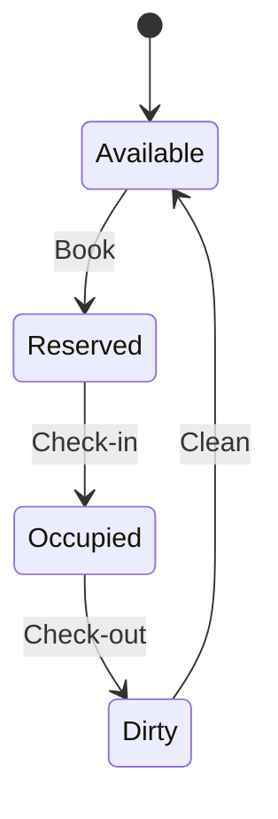

# TestPlan for Hotel Management System
**Prepared by Team 12**  
**Oct 31, 2026**

---

## MỤC LỤC
1. [Giới thiệu tổng quan & Mục tiêu](#1-giới-thiệu-tổng-quan--mục-tiêu)  
   1.1. [Bối cảnh dự án](#11-bối-cảnh-dự-án)  
   1.2. [Mục tiêu kiểm thử V&V (Verification & Validation)](#12-mục-tiêu-kiểm-thử-vv-verification--validation)  
2. [Phạm vi kiểm thử (Scope of Testing)](#2-phạm-vi-kiểm-thử-scope-of-testing)  
   2.1. [In-Scope (Nằm trong phạm vi kiểm thử)](#21-in-scope-nằm-trong-phạm-vi-kiểm-thử)  
   2.2. [Out-of-Scope (Nằm ngoài phạm vi kiểm thử)](#22-out-of-scope-nằm-ngoài-phạm-vi-kiểm-thử)  
3. [Chiến lược kiểm thử (Test Strategy)](#3-chiến-lược-kiểm-thử-test-strategy)  
   3.1. [Phương pháp & Kỹ thuật kiểm thử hộp đen (Black-box Techniques)](#31-phương-pháp--kỹ-thuật-kiểm-thử-hộp-đen-black-box-techniques)  
4. [Định nghĩa Test Suites & Phân bổ kỹ thuật kiểm thử](#4-định-nghĩa-test-suites--phân-bổ-kỹ-thuật-kiểm-thử)  
   - [Test Suite TS01: Authentication & Authorization (F01) - Ưu tiên P1](#test-suite-ts01-authentication--authorization-f01---ưu-tiên-p1)  
   - [Test Suite TS02: Reservation Management (F03) - Ưu tiên P1](#test-suite-ts02-reservation-management-f03---ưu-tiên-p1)  
   - [Test Suite TS03: Check-in / Check-out Operation (F04) - Ưu tiên P1](#test-suite-ts03-check-in--check-out-operation-f04---ưu-tiên-p1)  
   - [Test Suite TS04: Billing & Payment (F05) - Ưu tiên P1](#test-suite-ts04-billing--payment-f05---ưu-tiên-p1)  
   - [Test Suite TS05: Room & Housekeeping Management (F02 & F06) - Ưu tiên P2](#test-suite-ts05-room--housekeeping-management-f02--f06---ưu-tiên-p2)  
   - [Test Suite TS06: Service Management (F06) - Ưu tiên P2](#test-suite-ts06-service-management-f06---ưu-tiên-p2)  
   - [Test Suite TS07: Dashboard & Reports (F07) - Ưu tiên P3](#test-suite-ts07-dashboard--reports-f07---ưu-tiên-p3)  
5. [Ma trận kiểm thử ma trận phân quyền (RBAC Matrix Verification)](#5-ma-trận-kiểm-thử-ma-trận-phân-quyền-rbac-matrix-verification)  
6. [Môi trường kiểm thử & Dữ liệu thử nghiệm (Test Environment & Test Data)](#6-môi-trường-kiểm-thử--dữ-liệu-thử-nghiệm-test-environment--test-data)  
   6.1. [Cấu hình môi trường (Staging/Testbed)](#61-cấu-hình-môi-trường-stagingtestbed)  
   6.2. [Chiến lược dữ liệu thử nghiệm (Test Data Preparation)](#62-chiến-lược-dữ-liệu-thử-nghiệm-test-data-preparation)  
7. [Tiêu chí vào/ra & Tiêu chí dừng kiểm thử](#7-tiêu-chí-vàora--tiêu-chí-dừng-kiểm-thử)  
   7.1. [Tiêu chí bắt đầu kiểm thử (Entry Criteria)](#71-tiêu-chí-bắt-đầu-kiểm-thử-entry-criteria)  
   7.2. [Tiêu chí kết thúc kiểm thử (Exit Criteria)](#72-tiêu-chí-kết-thúc-kiểm-thử-exit-criteria)  
   7.3. [Tiêu chí tạm dừng và tiếp tục (Suspension & Resumption)](#73-tiêu-chí-tạm-dừng-và-tiếp-tục-suspension--resumption)  
8. [Quy trình quản lý lỗi & Đánh giá rủi ro (Defect Management & Risk Assessment)](#8-quy-trình-quản-lý-lỗi--đánh-giá-rủi-ro-defect-management--risk-assessment)  
   8.1. [Phân loại mức độ nghiêm trọng của lỗi (Defect Severity)](#81-phân-loại-mức-độ-nghiêm-trọng-của-lỗi-defect-severity)  
   8.2. [Đánh giá và kiểm soát rủi ro kiểm thử (Risk Management)](#82-đánh-giá-và-kiểm-soát-rủi-ro-kiểm-thử-risk-management)  
9. [Kế hoạch thực hiện & Sản phẩm bàn giao (Deliverables)](#9-kế-hoạch-thực-hiện--sản-phẩm-bàn-giao-deliverables)  
   9.1. [Lộ trình thực hiện (Testing Milestones)](#91-lộ-trình-thực-hiện-testing-milestones)  
   9.2. [Sản phẩm bàn giao (Deliverables)](#92-sản-phẩm-bàn-giao-deliverables)  

---

## 1. Giới thiệu tổng quan & Mục tiêu

### 1.1. Bối cảnh dự án
Hệ thống Quản lý Khách sạn (Hotel Management System - HMS) là giải pháp ứng dụng Web phục vụ vận hành nội bộ khách sạn gồm quản lý danh mục phòng, điều phối quy trình đặt phòng, thực hiện thủ tục Check-in/Check-out, thanh toán/kế toán hóa đơn và quản trị phân quyền nhân sự.

### 1.2. Mục tiêu kiểm thử V&V (Verification & Validation)
- **Verification (Xác minh):** Kiểm tra phần mềm đáp ứng đầy đủ và chuẩn xác các đặc tả kỹ thuật, ràng buộc dữ liệu và sơ đồ luân chuyển trạng thái (State Transition).
- **Validation (Xác nhận):** Đảm bảo hệ thống vận hành đúng quy trình thực tế của khách sạn, ngăn ngừa triệt để các rủi ro thất thoát doanh thu, xung đột tài nguyên (Overbooking) và vi phạm an toàn thông tin (vượt quyền/leo thang đặc quyền).

---

## 2. Phạm vi kiểm thử (Scope of Testing)

### 2.1. In-Scope (Nằm trong phạm vi kiểm thử)
- Kiểm thử toàn diện 7 module chức năng:
  - **F01:** Authentication & Authorization
  - **F02:** Room Management
  - **F03:** Reservation Management
  - **F04:** Check-in / Check-out
  - **F05:** Billing & Payment
  - **F06:** Service & Housekeeping Management
  - **F07:** Dashboard & Reports
- Kiểm thử 4 nhóm tác nhân (Actors): Admin, Hotel Manager, Receptionist, Housekeeping Staff.
- Kiểm chứng 8 Nhóm quy tắc nghiệp vụ bắt buộc: **BR01 đến BR08** (tương ứng chi tiết **BR-01 đến BR-124**).
- Kiểm thử phi chức năng: Bảo mật phân quyền (RBAC / Broken Access Control), Tính toàn vẹn dữ liệu khi xử lý đồng thời (Concurrency / Race Condition).

### 2.2. Out-of-Scope (Nằm ngoài phạm vi kiểm thử)
- Cổng giao tiếp/giao diện khách hàng tự đặt phòng (Public Online Booking Portal).
- Tích hợp cổng thanh toán thực tế của bên thứ 3 (Payment Gateway Sandbox thực: VNPay, MoMo, Stripe...; kiểm thử tập trung vào logic hạch toán thanh toán nội bộ với Mock Payment Gateway).
- Kiểm thử hiệu năng tải cao diện rộng (Stress/Soak testing quy mô triệu users).

---

## 3. Chiến lược kiểm thử (Test Strategy)

```text
+-----------------------------------------------------------------------------------+
|                            TEST LEVELS & APPROACH                                 |
+-----------------------------------------------------------------------------------+
|  Level 1: Unit Testing (Logic tính toán tiền phòng, phụ thu, thuế, discount)      |
|  Level 2: Integration Testing (API, Database Transactions, State Synchronization) |
|  Level 3: System Testing (End-to-End Hotel Flow, RBAC, Data Consistency)         |
|  Level 4: Acceptance / Business Scenario Testing (8 Business Rules)               |
+-----------------------------------------------------------------------------------+
```

### 3.1. Phương pháp & Kỹ thuật kiểm thử hộp đen (Black-box Techniques)

1. **Phân vùng tương đương (Equivalence Partitioning - EP):**  
   Áp dụng kiểm thử đầu vào: Số lượng khách, khoảng ngày đặt phòng, tỷ lệ chiết khấu, số tiền thanh toán.
2. **Phân tích giá trị biên (Boundary Value Analysis - BVA):**  
   Sức chứa phòng (Min = 1, Max = Capacity, Max + 1), thời gian lưu trú (Check-in = Check-out, Check-in > Check-out), hạn mức giảm giá (0%, 100%, âm hoặc > 100%).
3. **Bảng quyết định (Decision Table Testing):**  
   Áp dụng tính tiền hóa đơn phức hợp (F05) và xác thực điều kiện nhận/hủy đặt phòng (F03, F04).
4. **Kiểm thử chuyển đổi trạng thái (State Transition Testing):**  
   Áp dụng kiểm soát vòng đời của Phòng (F02/F06) và Đơn đặt phòng (F03/F04):



5. **Kiểm thử đồng thời (Concurrency Testing):**  
   Gửi đồng thời các request nhận/đặt cho cùng một phòng tại cùng một mốc thời gian để phát hiện lỗi Overbooking và vi phạm ràng buộc toàn vẹn ACID.

---

## 4. Định nghĩa Test Suites & Phân bổ kỹ thuật kiểm thử

### Test Suite TS01: Authentication & Authorization (F01) - Ưu tiên P1
- **Mục tiêu:** Xác minh tính an toàn phiên làm việc và kiểm soát quyền truy cập theo vai trò.
- **Kỹ thuật:** Security Testing, Functional Testing, Equivalence Partitioning.
- **Test Cases trọng tâm:**
  - `TC_AUTH_01`: Đăng nhập thành công với thông tin xác thực hợp lệ của từng vai trò (Admin, Manager, Receptionist, Housekeeping).
  - `TC_AUTH_02`: Chặn đăng nhập khi sai mật khẩu, tài khoản bị vô hiệu hóa (BVA/EP, BR-70, BR-71).
  - `TC_AUTH_03`: Kiểm tra xử lý Session/JWT token khi hết hạn (30 phút) hoặc đăng xuất (BR-72, BR-73, BR-74).
  - `TC_AUTH_04`: Thử nghiệm leo thang đặc quyền (Privilege Escalation): Housekeeping/Receptionist truy cập trực tiếp URL API quản trị hệ thống (`/api/admin/users`, `/users`) -> Chặn 403 Forbidden.

### Test Suite TS02: Reservation Management (F03) - Ưu tiên P1
- **Mục tiêu:** Đảm bảo toàn vẹn dữ liệu đặt phòng, tính toán ngày lưu trú và ngăn chặn tình trạng phòng ảo/trùng phòng.
- **Quy tắc nghiệp vụ:** BR01, BR02, BR08 (BR-01 đến BR-09, BR-20 đến BR-27, BR-60 đến BR-64).
- **Kỹ thuật:** EP, BVA, Decision Table, Concurrency Testing.
- **Test Cases trọng tâm:**
  - `TC_RES_01` (BR01, BR-03): Tạo đặt phòng với $	ext{Check-out Date} \le 	ext{Check-in Date} 
ightarrow$ Hệ thống báo lỗi.
  - `TC_RES_02` (BR01, BR-32): Số lượng khách nhập vào vượt quá sức chứa tối đa của loại phòng $
ightarrow$ Hệ thống từ chối.
  - `TC_RES_03` (BR02, BR-60): Đặt phòng đã có đơn xác nhận trong khoảng thời gian chồng lấn ($T_{	ext{start}} < T_{	ext{end\_existing}}$ và $T_{	ext{end}} > T_{	ext{start\_existing}}$) $
ightarrow$ Ngăn chặn thành công.
  - `TC_RES_04` (BR08, BR-64): Race condition test: 2 Lễ tân cùng ấn "Xác nhận đặt phòng" cho 1 phòng duy nhất tại cùng một mili-giây $
ightarrow$ Chỉ 1 request thành công, request còn lại báo lỗi xung đột (HTTP 409).

### Test Suite TS03: Check-in / Check-out Operation (F04) - Ưu tiên P1
- **Mục tiêu:** Kiểm tra luân chuyển trạng thái phòng và khách lưu trú.
- **Quy tắc nghiệp vụ:** BR03, BR04 (BR-10, BR-11, BR-80 đến BR-84).
- **Kỹ thuật:** State Transition Testing, Integration Testing.
- **Test Cases trọng tâm:**
  - `TC_CIO_01` (BR04, BR-80): Thực hiện Check-in một đơn đặt phòng có trạng thái Cancelled $
ightarrow$ Hệ thống chặn giao dịch.
  - `TC_CIO_02` (BR04, BR-83): Thực hiện Check-out một phòng đang ở trạng thái Reserved hoặc Available (chưa Check-in) $
ightarrow$ Hệ thống báo lỗi.
  - `TC_CIO_03` (BR03, BR-81): Check-in thành công $
ightarrow$ Trạng thái phòng đổi thành `Occupied`; Trạng thái đặt phòng đổi thành `Checked-in`.
  - `TC_CIO_04` (BR03, BR-83): Check-out thành công $
ightarrow$ Trạng thái phòng đổi thành `Cleaning` (Dirty / Chờ dọn); Đơn đặt phòng đổi thành `Checked-out`.

### Test Suite TS04: Billing & Payment (F05) - Ưu tiên P1
- **Mục tiêu:** Kiểm tra tính chính xác tuyệt đối về mặt toán học và logic hạch toán công nợ.
- **Quy tắc nghiệp vụ:** BR05, BR06 (BR-50 đến BR-55, BR-85 đến BR-91).
- **Kỹ thuật:** Unit Testing, BVA, Decision Table.
- **Công thức kiểm thử (BR-50):**
  $$	ext{Total Amount} = \sum 	ext{Room Charge} + \sum 	ext{Service Charge} + 	ext{Surcharge} + 	ext{Tax} - 	ext{Discount}$$
- **Test Cases trọng tâm:**
  - `TC_BILL_01` (BR05, BR-50): Tính tổng chi phí lưu trú nhiều ngày kèm phụ thu trả phòng muộn (Late Check-out, BR-11), dịch vụ minibar, phí dịch vụ 5% và thuế VAT 10%.
  - `TC_BILL_02` (BR05, BR-44): Ghi nhận giảm giá âm hoặc giảm giá $> 100\%$ giá trị $
ightarrow$ Hệ thống từ chối.
  - `TC_BILL_03` (BR06, BR-85): Thanh toán vượt quá số dư còn lại cần trả của hóa đơn $
ightarrow$ Chặn thanh toán thừa (HTTP 422).
  - `TC_BILL_04` (BR06, BR-90): Nhấn nút thanh toán liên tục (Double submission) $
ightarrow$ Hệ thống kích hoạt `Idempotency-Key` (UUID v4), chỉ ghi nhận 1 giao dịch duy nhất.

### Test Suite TS05: Room & Housekeeping Management (F02 & F06) - Ưu tiên P2
- **Mục tiêu:** Kiểm soát danh mục buồng phòng và phối hợp buồng phòng.
- **Quy tắc nghiệp vụ:** BR03, BR07 (BR-100 đến BR-104, BR-111 đến BR-114).
- **Kỹ thuật:** Validation Testing, Functional Testing, State Transition.
- **Test Cases trọng tâm:**
  - `TC_ROOM_01` (BR-100): Tạo mới phòng trùng số phòng đã tồn tại $
ightarrow$ Báo lỗi Duplicate (HTTP 409).
  - `TC_HK_01` (BR-112): Housekeeping truy cập danh sách phòng cần dọn $
ightarrow$ Chỉ thấy các phòng có trạng thái `Cleaning` (Dirty).
  - `TC_HK_02` (BR-112): Housekeeping hoàn tất dọn phòng $
ightarrow$ Chuyển trạng thái từ `Cleaning` sang `Available` (Ready to use).
  - `TC_HK_03` (BR-81): Kiểm tra việc gán phòng đang `Cleaning` (Dirty) cho khách Check-in mới $
ightarrow$ Báo cảnh báo/ngăn chặn nếu chưa hoàn thành vệ sinh.

### Test Suite TS06: Service Management (F06) - Ưu tiên P2
- **Mục tiêu:** Tích hợp việc tiêu dùng dịch vụ (giặt ủi, minibar, ăn uống, hư hao) vào hồ sơ phòng.
- **Kỹ thuật:** Integration Testing, Functional Testing.
- **Test Cases trọng tâm:**
  - `TC_SVC_01` (BR-34, BR-35, BR-37): Thêm dịch vụ vào phòng đang ở trạng thái `Occupied` (đơn `Checked-in`) $
ightarrow$ Tự động hạch toán vào Hóa đơn (F05).
  - `TC_SVC_02` (BR-37): Thêm dịch vụ vào phòng đang `Available` hoặc đã `Completed` check-out $
ightarrow$ Hệ thống chặn ghi nhận.

### Test Suite TS07: Dashboard & Reports (F07) - Ưu tiên P3
- **Mục tiêu:** Đối soát dữ liệu thống kê tổng hợp với số liệu giao dịch cơ sở dữ liệu.
- **Kỹ thuật:** Data Validation, Comparison Testing.
- **Test Cases trọng tâm:**
  - `TC_REP_01` (BR-122): So sánh tổng doanh thu hiển thị trên Dashboard kỳ T với tổng giá trị các hóa đơn thanh toán thành công (`ISSUED`) trong cơ sở dữ liệu kỳ T.
  - `TC_REP_02` (BR-120): Kiểm tra số lượng phòng trống thời gian thực trên sơ đồ phòng tương ứng chính xác với tổng số phòng vật lý trừ đi số phòng đang `Occupied`, `Reserved`, `Cleaning`, `Out of Service`.

---

## 5. Ma trận kiểm thử ma trận phân quyền (RBAC Matrix Verification)

Kiểm thử xác minh quy tắc **BR07 (BR-75, BR-79)** nhằm loại trừ rủi ro phân quyền sai sót:

| Mã chức năng | Thao tác | Admin | Hotel Manager | Receptionist | Housekeeping | Kỳ vọng kiểm thử (Expected Output) |
| :--- | :--- | :---: | :---: | :---: | :---: | :--- |
| **AUTH_01** | Quản lý User / Phân quyền | **ALLOW** | DENY (403) | DENY (403) | DENY (403) | Chỉ Admin được CRUD nhân sự |
| **ROOM_01** | Tạo / Sửa phòng, đổi giá | **ALLOW** | **ALLOW** | VIEW ONLY | VIEW ONLY | Lễ tân/Dọn phòng không thấy nút Save/Edit |
| **RES_01** | Tạo mới / Hủy đặt phòng | DENY (403) | **ALLOW** | **ALLOW** | DENY (403) | Admin/HK cố gọi API đặt phòng bị từ chối |
| **CIO_01** | Check-in / Check-out | DENY (403) | **ALLOW** | **ALLOW** | DENY (403) | Receptionist thực hiện đầy đủ |
| **BILL_01** | Tạo hóa đơn / Thanh toán | DENY (403) | **ALLOW** | **ALLOW** | DENY (403) | Thu ngân/Lễ tân quản lý công nợ |
| **HK_01** | Chuyển phòng Cleaning -> Available | DENY (403) | VIEW ONLY | VIEW ONLY | **ALLOW** | Housekeeping trực tiếp thao tác |
| **REP_01** | Báo cáo doanh thu chi tiết | **ALLOW** | **ALLOW** | RESTRICTED | DENY (403) | Lễ tân chỉ xem bảng phân bổ phòng ca trực |

---

## 6. Môi trường kiểm thử & Dữ liệu thử nghiệm (Test Environment & Test Data)

### 6.1. Cấu hình môi trường (Staging/Testbed)
- **Web Client:** Google Chrome (v120+), Mozilla Firefox (v120+), Microsoft Edge.
- **Application Server:** Node.js (Vite / React 18) / Java Spring Boot (JRE 17+).
- **Database:** PostgreSQL / LocalStorage Mock Database với dữ liệu cô lập.
- **Testing Tools:**
  - *Functional / API Testing:* Postman, Playwright, Vitest.
  - *Concurrency Testing:* Apache JMeter (giả lập 10 - 50 concurrent threads truy cập cùng lúc).
  - *Test Management:* Jira / GitHub Projects / Excel Test Log.

### 6.2. Chiến lược dữ liệu thử nghiệm (Test Data Preparation)
Khởi tạo bộ dữ liệu gốc (Data Seeding) bao gồm:
- **4 tài khoản** tương ứng 4 roles: `admin01`, `quanly01`, `letan01`, `donphong01` (Mật khẩu: `Hotel@2026`).
- **3 loại phòng** (Standard, Deluxe, Suite) với sức chứa lần lượt: 2 khách, 3 khách, 4 khách.
- **Danh mục 11 phòng:** 101-104 (Tầng 1), 201-204 (Tầng 2), 301-303 (Tầng 3).

---

## 7. Tiêu chí vào/ra & Tiêu chí dừng kiểm thử

### 7.1. Tiêu chí bắt đầu kiểm thử (Entry Criteria)
- Mã nguồn đã được build thành công, không có lỗi biên dịch (Compilation Errors).
- Các Unit Tests quan trọng cho module tính toán hóa đơn (F05) đạt tỷ lệ Pass 100%.
- Môi trường kiểm thử đã được triển khai đầy đủ dữ liệu mẫu (Seeded Data).

### 7.2. Tiêu chí kết thúc kiểm thử (Exit Criteria)
- 100% các Test Cases thuộc nhóm ưu tiên P1 (Reservation, Check-in/Out, Billing, Auth) được thực thi hoàn tất.
- Không còn tồn đọng lỗi mức độ **Critical** hoặc **Major** chưa giải quyết.
- Tỷ lệ Pass chung của toàn bộ Test Cases đạt tối thiểu $\ge 95\%$.
- Ma trận phân quyền (RBAC Matrix) đạt kết quả Pass 100%.

### 7.3. Tiêu chí tạm dừng và tiếp tục (Suspension & Resumption)
- **Tạm dừng (Suspension):** Hệ thống gặp lỗi sập server (Crash), cơ sở dữ liệu ngắt kết nối hoặc module Authentication bị lỗi khiến tester không thể đăng nhập vào hệ thống.
- **Tiếp tục (Resumption):** Khi lỗi hạ tầng/đăng nhập được khắc phục hoàn toàn và triển khai lại bản vá (Hotfix).

---

## 8. Quy trình quản lý lỗi & Đánh giá rủi ro (Defect Management & Risk Assessment)

### 8.1. Phân loại mức độ nghiêm trọng của lỗi (Defect Severity)
- **Severity 1 (Critical):** Hệ thống crash, mất dữ liệu, xảy ra Overbooking, lỗi hạch toán tính sai tiền hóa đơn, rò rỉ phân quyền tài khoản Admin.
- **Severity 2 (Major):** Lỗi chức năng cốt lõi nhưng có phương án thay thế tạm thời (Workaround), ví dụ: không in được hóa đơn trực tiếp nhưng vẫn lưu được bản mềm PDF.
- **Severity 3 (Minor):** Lỗi giao diện người dùng (UI lệch dòng), lỗi thông báo lỗi chưa thân thiện.
- **Severity 4 (Trivial):** Lỗi chính tả, định dạng phông chữ nhẹ.

### 8.2. Đánh giá và kiểm soát rủi ro kiểm thử (Risk Management)

| Rủi ro (Risk) | Khả năng | Tác động | Giải pháp giảm thiểu (Mitigation Strategy) |
| :--- | :---: | :---: | :--- |
| **Xảy ra Race Condition khi đặt cùng 1 phòng** | Cao | Rất cao | Thiết kế kịch bản kiểm thử tải đồng thời với JMeter / Playwright; yêu cầu dev dùng Pessimistic/Optimistic Locking (BR-64, BR-92). |
| **Sai lệch công nợ do thiếu trường dữ liệu** | Trung bình | Cao | Lập bảng quyết định (Decision Table) phủ hết các nhánh tính tiền trước khi viết code kiểm thử (BR-50). |
| **Thiếu thời gian chạy toàn bộ kịch bản** | Cao | Trung bình | Ưu tiên tuyệt đối Test Suites P1; áp dụng tự động hóa cho Smoke Test và Regression Test. |

---

## 9. Kế hoạch thực hiện & Sản phẩm bàn giao (Deliverables)

### 9.1. Lộ trình thực hiện (Testing Milestones)
- **Giai đoạn 1:** Soạn thảo Test Plan, Review & Baseline tài liệu.
- **Giai đoạn 2:** Thiết kế chi tiết Test Cases theo kỹ thuật EP, BVA, Decision Table, State Transition.
- **Giai đoạn 3:** Thực thi Test Suites P1 (F01, F03, F04, F05), log defects và re-test.
- **Giai đoạn 4:** Thực thi Test Suites P2 & P3 (F02, F06, F07) và Regression Testing.
- **Giai đoạn 5:** Lập Báo cáo tổng kết kiểm thử (Test Summary Report) phục vụ nghiệm thu đồ án V&V.

### 9.2. Sản phẩm bàn giao (Deliverables)
1. Tài liệu Kế hoạch kiểm thử hoàn chỉnh (`Test_Plan_HMS.md`).
2. Bảng thiết kế kịch bản chi tiết (`Test_Cases_Specification.xlsx`).
3. Báo cáo theo dõi lỗi (`Defect_Log_Report.xlsx`).
4. Báo cáo tổng kết chất lượng phần mềm (`V&V_Final_Evaluation_Report.pdf`).
